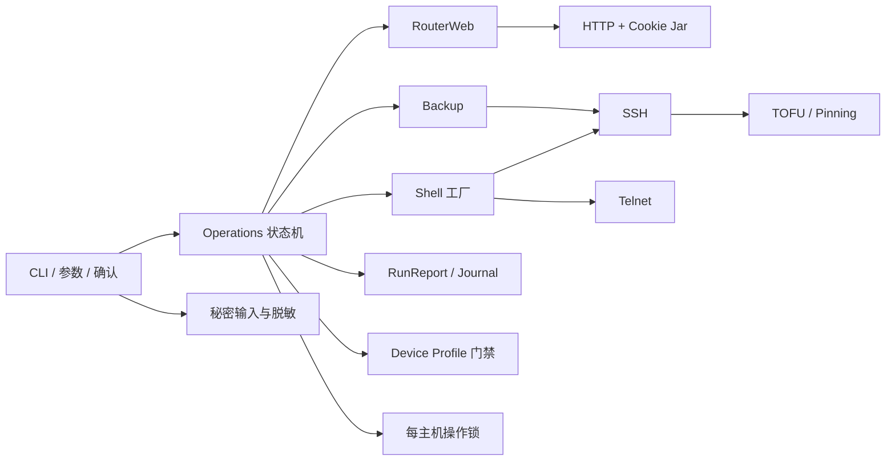
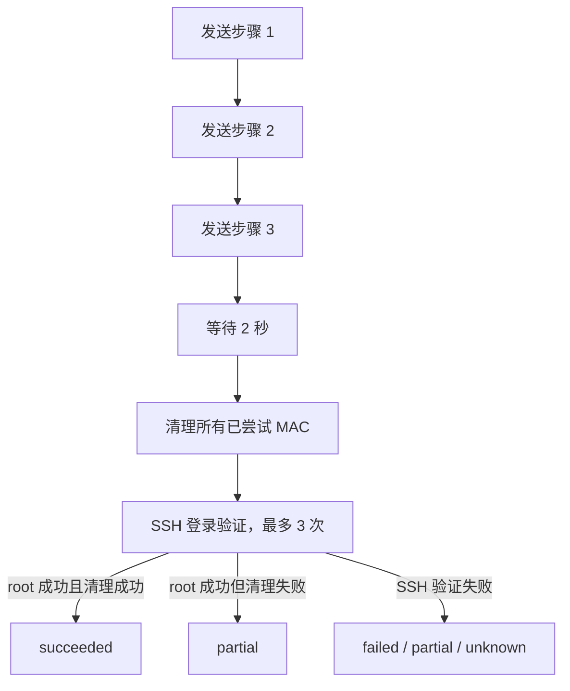

# RD08 SSH 管理工具 Go 独立实现规格与交付计划

> **文档性质**：自包含产品需求、技术设计与验收规格
>
> **版本**：v1.0
>
> **日期**：2026-11-25
>
> **受众**：Go 开发、测试、安全评审、发布与验收人员
>
> **目标产物**：跨平台单文件 CLI，暂定名 `rd08ctl`

## TL;DR

本项目使用 Go 独立实现一套运行于电脑端的 RD08 路由器 SSH 管理工具。实现者只需要本文（含内嵌测试向量与夹具要求），不需要读取、克隆、复制或调用原参考仓库，也不需要 Python、.NET、第三方补丁器或路由器端 Go 程序。

完整交付范围包括：设备预检、Web 登录、临时开启并真实验证 SSH、软固化安装与移除、重启验证、全 MTD 分区只读备份与本地校验、带三次重启检查的深度固化、运行报告、结构化错误和安全确认机制。深度固化涉及 `bdata` 与 `crash` 分区，必须作为独立高风险流程实现，不得包装成无条件“一键到底”。

本文中的「必须」「不得」是验收要求，「建议」是可调整实现建议。协议、远程命令和状态判定已经给出；若实现者发现真实设备行为与本文不符，应停止变更流程并补充兼容性证据，不得自行猜测后继续写设备。

## 目录

- [1. 项目目标与边界](#1-项目目标与边界)
- [2. 完整功能范围](#2-完整功能范围)
- [3. 支持矩阵与前置条件](#3-支持矩阵与前置条件)
- [4. CLI 产品规格](#4-cli-产品规格)
- [5. 总体架构与代码组织](#5-总体架构与代码组织)
- [6. 核心数据模型](#6-核心数据模型)
- [7. Web API 与登录算法规格](#7-web-api-与登录算法规格)
- [8. MAC 规则命令通道](#8-mac-规则命令通道)
- [9. SSH 与 Telnet Shell 规格](#9-ssh-与-telnet-shell-规格)
- [10. 设备预检与状态验证](#10-设备预检与状态验证)
- [11. 临时开启 SSH](#11-临时开启-ssh)
- [12. 软固化与移除](#12-软固化与移除)
- [13. 重启及重启后验证](#13-重启及重启后验证)
- [14. 全分区备份与校验](#14-全分区备份与校验)
- [15. 深度固化](#15-深度固化)
- [16. 安全、凭据、日志与并发](#16-安全凭据日志与并发)
- [17. 错误模型与退出码](#17-错误模型与退出码)
- [18. 测试方案](#18-测试方案)
- [19. 构建、发布与交付物](#19-构建发布与交付物)
- [20. 实施阶段与依赖关系](#20-实施阶段与依赖关系)
- [21. 最终验收标准](#21-最终验收标准)
- [22. 风险与明确限制](#22-风险与明确限制)
- [23. Agent 接入（MCP）](#23-agent-接入mcp)
- [附录 A：固定常量与测试向量](#附录-a固定常量与测试向量)
- [附录 B：需求追踪矩阵](#附录-b需求追踪矩阵)

## 1. 项目目标与边界

### 1.1 项目目标

1. 将已知 RD08 设备操作流程实现为可维护、可测试、可分发的 Go CLI。
2. 用户下载对应平台的单个二进制后即可运行，无需安装语言运行时。
3. 所有成功结论必须由实际状态验证支持，不能把 HTTP 200、TCP 端口开放或远程命令已发送误判为成功。
4. 对可重复执行的只读操作提供重试；对可能造成写操作已执行但响应丢失的场景禁止盲目重试。
5. 对高风险操作提供预检、备份、明确确认、阶段日志和失败停止机制。
6. 运行时不访问互联网，不发送遥测，不依赖原参考项目或第三方在线服务。

### 1.2 工具运行位置

`rd08ctl` 运行在用户电脑上，通过局域网访问路由器：

- HTTP：管理登录和 MAC 规则命令通道。
- SSH：首选 root Shell、分区备份和最终验证。
- Telnet：仅在用户明确允许时作为深度固化过程中的应急 Shell。

不要求、也不建议把 Go 二进制交叉编译后装入路由器。路由器端只使用固件已有的 `nvram`、`bdata`、`mtd`、`dropbear`、`uci`、`base64`、`sed` 等程序。

### 1.3 独立实现要求

1. 代码必须依据本文独立编写，不得复制原项目源文件。
2. 构建、单元测试、集成测试和运行均不得引用原仓库路径。
3. 原参考仓库仅作为本文编写时的行为来源，不属于实现依赖；追溯基线为 commit `a5af1c1569e6817abe386f26d5bc59f0290c546d`。
4. 实现仓库应自行选择许可证，并检查所有 Go 依赖的许可证；参考来源没有许可证这一事实不得被解释为可以任意复制其代码。
5. 本文列出的 Shell 命令、HTTP 字段和算法属于设备互操作契约，应通过测试固定行为，而不是通过复制实现获得。

### 1.4 非目标

首版明确不实现以下能力：

- 不支持 RD08 以外的型号，也不承诺支持除 `1.1.96` 以外的固件。
- 不扫描网络、不批量发现或操作路由器。
- 不提供未认证登录、密码猜测或绕过管理员认证的功能。
- 不提供任意远程 Shell 命令输入框或通用 `exec` 子命令。
- 不实现固件刷写、自动恢复分区、自动回滚 `bdata` 或自动救砖。
- 不实现深度固化的自动断点续跑；中断后只提供阶段报告，禁止从第一步盲目重跑。
- 不实现面向互联网的服务或接口。控制入口只有 CLI、桌面端和 Agent 接入的 MCP 服务（§23）；MCP 服务默认不运行，只有用户启动 `routerctl mcp` 时才提供，HTTP 方式始终要求访问令牌。
- 不保证开启 SSH 在固件升级、恢复出厂或更换硬件后仍然有效。

## 2. 完整功能范围

### 2.1 功能清单

| ID   | 功能                        | 交付要求     | 成功判定                                      |
| ---- | --------------------------- | ------------ | --------------------------------------------- |
| F-01 | 版本与配置                  | 必须         | 能显示版本、构建信息及有效默认配置            |
| F-02 | 设备预检 `doctor`           | 必须         | 输出设备身份、固件、兼容性和通道状态          |
| F-03 | 临时开启 `enable`           | 必须         | 实际 SSH 登录且 `id -u` 为 `0`                |
| F-04 | 登录验证 `verify`           | 必须         | 指定传输协议登录并验证 root                   |
| F-05 | 软固化 `persist soft`       | 必须         | 文件哈希、权限、语法和 UCI 值全部匹配         |
| F-06 | 移除软固化 `persist remove` | 必须         | 仅移除工具管理的自启项并读回确认              |
| F-07 | 重启验证 `reboot-verify`    | 必须         | 观察到下线、新 `boot_id` 和最终 SSH root 登录 |
| F-08 | 分区备份 `backup create`    | 必须         | 每个 MTD 分区长度和本地 SHA-256 校验通过      |
| F-09 | 备份校验 `backup verify`    | 必须         | 重新计算本地文件哈希并验证 manifest           |
| F-10 | 深度固化 `deep-persist`     | 必须，高风险 | 三次重启、标志读回、最终软固化和 SSH 验证通过 |
| F-11 | 主机密钥保护                | 必须         | 首次确认或固定指纹，密钥变化默认失败          |
| F-12 | 运行报告与 JSON             | 必须         | 阶段可追溯且报告不含密码、`stok` 等秘密       |
| F-13 | MAC 规则清理                | 必须         | 所有已尝试添加的规则均执行删除并记录结果      |

### 2.2 本文新增的安全能力

以下不是简单行为照搬，而是本规格要求新增的工程能力：

- 严格型号和固件门禁。
- SSH 主机密钥 TOFU/pinning。
- 隐藏密码输入、非交互秘密输入和日志脱敏。
- 工具自身实现全 MTD 分区备份，不再依赖外部补丁器。
- 深度固化前置备份校验、设备布局比对和本地阶段 journal。
- 软固化冲突检测、原子文件替换和安全移除。
- 统一错误码、结构化运行报告和防并发操作。

## 3. 支持矩阵与前置条件

### 3.1 初始兼容配置

只内置一个名为 `rd08-1.1.96` 的设备 profile：

| 字段           | 值                    |
| -------------- | --------------------- |
| 型号           | 小米 BE6500 Pro       |
| 硬件标识       | `RD08`                |
| 已验证目标固件 | `1.1.96`              |
| 默认管理地址   | `192.168.31.1`        |
| Web            | HTTP，端口 `80`       |
| SSH            | TCP `22`，用户 `root` |
| Telnet         | TCP `23`，用户 `root` |
| SSH 服务       | 固件自带 Dropbear     |

版本比较使用去首尾空格后的精确字符串匹配，不做“高于某版本即可”的推断。设备身份按以下顺序判断：

1. `hardware` 非空时，必须等于 `RD08`，不区分大小写。
2. `hardware` 缺失时，允许 `displayName` 明确包含 `BE6500 Pro`，但仍须核对固件。
3. 两者均缺失或无法确认时，变更命令必须失败关闭；`doctor` 可以输出「未知」。
4. 首版不提供跳过型号或固件检查的 `--force`。

### 3.2 用户前置条件

- 仅对本人所有或明确获授权的设备操作。
- 电脑与路由器位于同一可达局域网，且中间没有隔离管理流量的访客网络策略。
- 用户知道 Web 管理密码；`enable` 还需要指定新的 SSH root 密码。
- 后续 Shell 操作需要当前有效的 root 密码。
- 深度固化前必须保持供电和网络稳定，停止其他管理后台写操作。
- 深度固化实机验收必须在可承受变砖风险的测试设备上进行，并准备官方恢复手段。

### 3.3 密码规则

管理密码和 root 密码均遵守：

1. 必须是非空、有效 UTF-8 字符串。
2. 不得包含 `U+0000` 至 `U+001F`、`U+007F`，因此换行、回车、NUL、Tab 均不允许。
3. 不做 Trim，不做 Unicode 规范化；首尾空格必须原样保留。
4. UTF-8 编码后最大 1024 字节，超出时在网络或设备变更前拒绝。
5. 不允许通过命令行字面参数或环境变量传密码。
6. root 密码通过 Base64 仅做传输转义；Base64 不是加密，日志仍不得出现该值对应的可逆密码数据。

## 4. CLI 产品规格

### 4.1 命令树

```text
rd08ctl
├── version
├── profiles
├── doctor
├── setup
├── enable
├── verify
├── persist
│   ├── soft
│   └── remove
├── reboot-verify
├── backup
│   ├── create
│   └── verify
├── deep-persist
├── recovery
│   └── ack
├── credentials
│   ├── list
│   └── forget
├── mcp
│   ├── token
│   └── config
└── skill
    ├── show
    └── install
```

`setup` 是引导流程（§10.4）；`recovery ack` 记录对不确定变更的人工检查（§16.6）；`credentials` 列出或忘记已保存的密码（§16.7）；`mcp` 启动 Agent 接入的 MCP 服务，`mcp token` 生成 HTTP 访问令牌，`mcp config` 输出各 Agent 宿主的接入配置，`skill` 输出或安装随附的 Agent skill（§23）。

### 4.2 全局参数

| 参数                    | 默认值                                                           | 说明                                                 |
| ----------------------- | ---------------------------------------------------------------- | ---------------------------------------------------- |
| `--host`                | `192.168.31.1`                                                   | IP 或主机名；变更操作前解析并固定本次连接地址        |
| `--web-port`            | `80`                                                             | Web HTTP 端口                                        |
| `--ssh-port`            | `22`                                                             | SSH 端口                                             |
| `--telnet-port`         | `23`                                                             | Telnet 端口                                          |
| `--config`              | OS 用户配置路径                                                  | JSON 配置文件，不保存秘密                            |
| `--profile`             | `rd08-1.1.96`                                                    | 首版唯一可选 profile                                 |
| `--json`                | `false`                                                          | stdout 仅输出 JSON 报告，日志写 stderr               |
| `--non-interactive`     | `false`                                                          | 禁止交互提问；缺少秘密或确认即失败                   |
| `--allow-telnet`        | `false`                                                          | 允许 Shell 回退到 Telnet；深度固化必须显式开启       |
| `--host-key-sha256`     | 空                                                               | 固定预期 SSH 主机密钥 SHA-256 指纹                   |
| `--accept-new-host-key` | `false`                                                          | 非交互模式接受此前未知主机密钥；不得接受变化的旧密钥 |
| `--run-dir`             | 报告：系统临时目录下自动生成；deep journal：§15.3(11) 的托管目录 | 报告和 journal 保存目录                              |
| `--log-level`           | `info`                                                           | `debug`、`info`、`warn`、`error`；debug 也不输出秘密 |
| `--yes`                 | `false`                                                          | 确认普通变更；不能替代深度固化专用确认               |
| `--use-saved-password`  | `false`                                                          | 缺少的密码从应用保险库填入（§16.7）                  |
| `--remember-password`   | `false`                                                          | 设备接受输入的密码后保存到应用保险库（§16.7）        |

### 4.3 秘密输入

默认从 TTY 隐藏输入，不显示字符或星号。无法隐藏时，交互模式必须明确警告；`--non-interactive` 下直接失败，不得退回可见输入。

提供两个参数：

```text
--admin-password-stdin
--root-password-stdin
```

规则如下：

1. 只设置一个时，从 stdin 读取一行。
2. 两者同时设置时，按「第一行管理密码、第二行 root 密码」读取。
3. 只移除行尾的一个 LF 或 CRLF，不移除其他空格。
4. stdin 提前 EOF、存在多余非空行或密码校验失败时，在任何设备变更前退出。
5. 密码不写入配置文件、命令帮助、进程标题、报告或日志。唯一允许的持久形式是用户选择记住后，保存在应用保险库中的 AES-256-GCM 密文（§16.7）。通过 MCP 工具参数收到的密码适用同样的规则（§23.5）。

### 4.4 各命令输入与行为

| 命令             | 需要的秘密                                            | 默认传输                       | 设备写操作                                    |
| ---------------- | ----------------------------------------------------- | ------------------------------ | --------------------------------------------- |
| `doctor`         | 管理密码可选                                          | HTTP；SSH 仅在提供 root 密码时 | 无                                            |
| `enable`         | 管理密码 + 新 root 密码                               | HTTP，随后 SSH                 | NVRAM、Dropbear、root 密码、临时 MAC 规则     |
| `verify`         | 当前 root 密码                                        | SSH；指定时可用 Telnet         | 仅执行 `id -u`                                |
| `persist soft`   | 当前 root 密码                                        | SSH；可显式允许 Telnet         | `/data` 文件和 UCI                            |
| `persist remove` | 当前 root 密码                                        | SSH；可显式允许 Telnet         | 删除工具管理的自启项                          |
| `reboot-verify`  | 当前 root 密码                                        | SSH；可按参数回退              | 重启设备                                      |
| `backup create`  | 当前 root 密码                                        | 仅 SSH                         | 路由器只读，本地写备份                        |
| `backup verify`  | 纯本地无需秘密；在线校验需 root 密码                  | 无；在线附加检查用 SSH         | 默认仅本地读取，在线模式仅只读检查            |
| `deep-persist`   | 当前 root 密码                                        | SSH + 显式允许的 Telnet        | 高风险分区与配置写入、三次重启                |
| `setup`          | 按计划所需：当前 root 密码，或管理密码 + 新 root 密码 | HTTP 探测，随后仅 SSH          | 只执行确认过的步骤（§10.4）；`--plan-only` 无 |
| `recovery ack`   | 无                                                    | 无，只写本地恢复记录           | 无                                            |

### 4.5 使用示例

```bash
# 只读预检，并交互输入管理密码验证 Web 登录
rd08ctl doctor --host 192.168.31.1 --with-admin-auth

# 临时开启并真实验证 SSH
rd08ctl enable --host 192.168.31.1

# 验证当前 root 密码和 root 身份
rd08ctl verify --host 192.168.31.1

# 安装、验证软固化
rd08ctl persist soft --host 192.168.31.1

# 备份所有 MTD 分区到新目录；不带 --output 时使用 §14.2 的托管目录
rd08ctl backup create --host 192.168.31.1 --output ./rd08-backup-20261125

# 只读检测并显示计划，再按确认执行缺少的步骤
rd08ctl setup --plan-only
rd08ctl setup

# 本地重新校验备份
rd08ctl backup verify --dir ./rd08-backup-20261125

# 高风险操作示例；实际还需要专用确认和有效备份
rd08ctl deep-persist --host 192.168.31.1 \
  --backup-dir ./rd08-backup-20261125 \
  --allow-telnet \
  --ack-deep RD08-DEEP
```

`--output` 可选，未指定时在 §14.2 的托管目录下新建备份目录；`--dir` 是 `backup verify` 的必填参数；`--backup-dir` 是 `deep-persist` 的必填参数。

`verify` 另支持 `--transport ssh|telnet|auto`，默认 `ssh`。其他需要 Shell 的命令默认仅 SSH；只有 `--allow-telnet` 时才按 SSH、Telnet 顺序回退。`backup create` 是例外，任何时候都只允许 SSH。

`doctor` 默认只做无需密码的检查；`--with-admin-auth` 明确要求验证 Web 登录，`--with-root-verify` 明确要求验证 root。交互模式下设置相应开关后才询问密码，非交互模式则要求对应的 stdin 秘密参数。

`backup verify` 默认纯本地运行；只有显式设置 `--online` 才连接设备，并要求 root 密码。深度固化内部必须执行同等在线校验，但不能因为全局 `--host` 有默认值就隐式触发普通 `backup verify` 的在线模式。

### 4.6 输出要求

人类可读模式至少输出：

- 设备型号、固件、兼容性。
- 当前阶段和是否可重试。
- 清理警告和剩余 MAC 规则。
- 备份目录、分区数、总字节数和 manifest 路径。
- 深度固化中断阶段及「不要从头重跑」提示。
- 最终 SSH 示例 `ssh root@<host>`，不得输出密码。

JSON 模式遵守：

- stdout 只有一个完整 JSON 对象，不能夹带进度文本。
- 进度和错误日志写 stderr，同样脱敏。
- 非零退出也必须尽量生成结构化报告。
- 所有时间使用 RFC 3339，带时区。

### 4.7 配置文件

配置文件为 JSON，参数优先级为「显式 CLI 参数 > 配置文件 > 内置默认值」。示例：

```json
{
  "schema_version": 1,
  "host": "192.168.31.1",
  "web_port": 80,
  "ssh_port": 22,
  "telnet_port": 23,
  "profile": "rd08-1.1.96",
  "log_level": "info",
  "known_hosts_file": ""
}
```

`known_hosts_file` 为空时使用 OS 用户配置目录下的 `rd08ctl/known_hosts`。默认配置位置：

- Linux：`${XDG_CONFIG_HOME:-$HOME/.config}/rd08ctl/config.json`。
- macOS：`$HOME/Library/Application Support/rd08ctl/config.json`。
- Windows：`%APPDATA%\rd08ctl\config.json`。

未知字段、错误类型和非法端口必须报错，不得静默忽略。配置文件出现 `password`、`token`、`stok`、`key`、`nonce` 等秘密字段时拒绝加载。默认路径中环境变量的展开只用于定位本地配置，不用于传入密码。

## 5. 总体架构与代码组织

### 5.1 组件图



### 5.2 模块职责

| 模块         | 职责                                | 不得承担        |
| ------------ | ----------------------------------- | --------------- |
| `cli`        | 参数、交互、退出码、JSON 输出       | 直接拼远程命令  |
| `routerweb`  | 页面解析、登录、MAC 规则增删        | SSH/Telnet 逻辑 |
| `shell`      | 统一命令执行、退出码、流读取、超时  | 业务流程        |
| `operations` | 预检、开启、固化、重启状态机        | 底层协议细节    |
| `backup`     | MTD 解析、流式下载、manifest 和校验 | 分区恢复        |
| `safety`     | 主机密钥、确认、锁、秘密校验        | 设备 API        |
| `report`     | 阶段报告、journal、脱敏错误         | 远程写入        |
| `profiles`   | 设备常量、兼容矩阵和命令契约        | 用户配置        |

### 5.3 建议目录

```text
cmd/rd08ctl/main.go
internal/cli/{root,commands,secrets,output}.go
internal/config/config.go
internal/profiles/rd08_1_1_96.go
internal/routerweb/{client,login,macfilter,types}.go
internal/shell/{shell,ssh,telnet,quote,errors}.go
internal/operations/{doctor,enable,verify,soft_persist,reboot,deep_persist}.go
internal/backup/{create,verify,manifest,mtd}.go
internal/safety/{confirm,hostkey,lock,password}.go
internal/report/{report,journal,redact}.go
internal/testutil/{fake_web,fake_shell,fake_clock}.go
testdata/{web,http,mtd,reports}/
docs/{usage,recovery,compatibility}.md
Makefile
go.mod
LICENSE
THIRD_PARTY_NOTICES.md
```

### 5.4 技术选型

- Go：实施时选择仍受支持的稳定版本，并在 `go.mod` 固定最低版本和 `toolchain`。
- CLI：`github.com/spf13/cobra`。
- SSH：`golang.org/x/crypto/ssh` 和 `ssh/knownhosts`。
- 隐藏输入：`golang.org/x/term`。
- 跨进程锁：建议使用 `github.com/gofrs/flock` 的非阻塞 `TryLock`。
- 日志：标准库 `log/slog`。
- 配置与报告：标准库 `encoding/json`。
- 测试：标准库 `testing`、`net/http/httptest`；本地 SSH fake 可使用纯 Go 测试服务。

除测试和构建阶段下载 Go module 外，产物运行不需要 CGO 或外部动态库。

## 6. 核心数据模型

以下为语义模型，字段名可以在 Go 风格下调整，但信息不得丢失。

### 6.1 设备信息

```go
type DeviceInfo struct {
    DeviceID       string `json:"device_id"`
    Hardware       string `json:"hardware,omitempty"`
    DisplayName    string `json:"display_name,omitempty"`
    ROMVersion     string `json:"rom_version"`
    NewEncryptMode int    `json:"new_encrypt_mode"`
    Profile        string `json:"profile"`
    Compatible     bool   `json:"compatible"`
}
```

`DeviceID` 来自 Web 页面，`Hardware`、`DisplayName`、`ROMVersion` 和加密模式来自 `init_info`。未知字段保留不出现在公开报告中，避免无意泄露序列号等信息。

### 6.2 统一 Shell 结果

```go
type CommandResult struct {
    Stdout   []byte
    Stderr   []byte
    ExitCode int
    Started  bool
}

type Shell interface {
    Run(ctx context.Context, command string, options RunOptions) (CommandResult, error)
    Close() error
}
```

约束：

1. `Started` 表示命令是否已经提交给远端，用于区分「未发送」和「发送后连接中断」。
2. 非零退出码必须返回 `CommandResult` 和 `RemoteCommandError`，不能仅返回字符串。
3. 普通命令 stdout、stderr 各默认限制 4 MiB；备份二进制流使用独立接口，不受该限制。
4. 超限、超时或协议失步必须关闭当前连接，不得继续复用。
5. 命令成功的条件是退出码 `0`，不是「有输出」。

### 6.3 运行报告

```go
type RunReport struct {
    SchemaVersion int               `json:"schema_version"`
    OperationID   string            `json:"operation_id"`
    Operation     string            `json:"operation"`
    Status        string            `json:"status"`
    Stage         string            `json:"stage"`
    Host          string            `json:"host"`
    Device        DeviceInfo        `json:"device"`
    StartedAt     time.Time         `json:"started_at"`
    EndedAt       *time.Time        `json:"ended_at,omitempty"`
    InitialBootID string            `json:"initial_boot_id,omitempty"`
    FinalBootID   string            `json:"final_boot_id,omitempty"`
    AttemptedMACs []string          `json:"attempted_macs,omitempty"`
    Cleanup       []CleanupResult   `json:"cleanup,omitempty"`
    BackupDir     string            `json:"backup_dir,omitempty"`
    Error         *StructuredError  `json:"error,omitempty"`
    Warnings      []string          `json:"warnings,omitempty"`
}
```

`Status` 只能是：

- `running`：仍在执行。
- `succeeded`：全部成功条件满足。
- `failed`：明确失败，且能确定当前远程步骤未执行或未生效。
- `partial`：部分步骤已成功或清理失败。
- `unknown`：写请求发送后超时、断连，无法判断远端是否执行。
- `canceled`：用户在新的设备写操作前取消。

每次阶段变化先写本地临时文件，`fsync` 后原子 rename；报告文件权限为 `0600`，目录为 `0700`。

### 6.4 统一错误

```go
type StructuredError struct {
    Code       string `json:"code"`
    Message    string `json:"message"`
    Retryable  bool   `json:"retryable"`
    Stage      string `json:"stage"`
    RemoteCode *int   `json:"remote_code,omitempty"`
}
```

错误链可以保留在内存供 debug 使用，但输出前必须经过统一脱敏器。

## 7. Web API 与登录算法规格

### 7.1 HTTP 客户端固定行为

1. Base URL 只支持 `http://<host>:<web-port>`。
2. 使用带 Cookie Jar 的 `http.Client`，在同一会话中保存 Cookie。
3. 禁止自动跟随重定向；遇到 3xx 按协议错误处理并显示目标路径，不输出敏感 Location 内容。
4. 连接、请求和读取均受 context 控制。
5. GET 页面与 `init_info` 总超时 5 秒；登录 POST 5 秒；MAC 添加 20 秒；MAC 删除 8 秒。
6. 普通响应体上限 1 MiB，超出即失败。
7. API 要求 HTTP 状态为 2xx，且 JSON 顶层为对象。
8. API 的 `code` 同时接受 JSON 数字 `0` 和字符串 `"0"`；其他数字、字符串或缺失均不是成功。
9. 表单使用 `application/x-www-form-urlencoded`，通过 `url.Values.Encode()` 编码，不得手拼请求体。
10. 不记录登录响应全文、`token`、页面中的 `key` 或密码哈希。

### 7.2 API 列表

| 用途            | 方法与路径                                                         |
| --------------- | ------------------------------------------------------------------ |
| 登录页面        | `GET /cgi-bin/luci/web`                                            |
| 设备信息        | `GET /cgi-bin/luci/api/xqsystem/init_info`                         |
| 登录            | `POST /cgi-bin/luci/api/xqsystem/login`                            |
| 已认证 MAC 规则 | `POST /cgi-bin/luci/;stok=<stok>/api/xqsystem/set_macfilter_rules` |

构造已认证路径时，固定分号路径格式，不得把 `stok` 放到 query 中代替。`stok` 必须作为单个路径参数安全编码，不能允许 `/`、`?`、`#` 改变 URL 结构。

### 7.3 页面字段提取

从登录页面提取：

- `deviceId`：匹配 `var deviceId = '<值>'`。
- `key`：匹配 `key: '<值>',`。

解析器允许字段周围存在空白，并建议同时支持双引号。字段缺失、为空或出现多个不一致值时必须失败。不要用 HTML 全文模糊搜索取得第一个任意 `key`。

### 7.4 `init_info` 字段

至少解析：

```json
{
  "newEncryptMode": 1,
  "displayName": "Xiaomi Router BE6500 Pro",
  "hardware": "RD08",
  "romversion": "1.1.96"
}
```

`newEncryptMode` 接受数字 `1` 或字符串 `"1"` 表示 SHA-256；其他已定义值使用 SHA-1。若字段类型无法解析，不得静默选择弱算法，应返回协议错误。

### 7.5 登录算法

定义 `H`：对 UTF-8 字节计算指定摘要并输出小写十六进制字符串。定义 `+`：普通字符串拼接，不加入分隔符。

```text
nonce = "0_" + deviceId + "_" + Unix秒时间戳 + "_" + 随机整数
inner = H(Web管理密码 + key)
passwordHash = H(nonce + inner)
```

随机整数范围为 `[1000, 10000]`，使用 `crypto/rand`；时间由可注入 Clock 提供。登录表单为：

| 字段       | 值             |
| ---------- | -------------- |
| `username` | `admin`        |
| `password` | `passwordHash` |
| `logtype`  | `2`            |
| `nonce`    | 上述 `nonce`   |

响应必须满足 `code == 0`，并含非空字符串 `token`。该 `token` 即后续路径中的 `stok`。非零 `code` 统一归类为登录失败，不重试密码。

### 7.6 固定登录测试向量

输入：

```text
deviceId = AABBCCDDEEFF
key = test-key
Web管理密码 = admin
Unix秒 = 1700000000
随机整数 = 4321
nonce = 0_AABBCCDDEEFF_1700000000_4321
```

SHA-1 分支：

```text
inner = a494919375559c6809d8486173a0db3e2fb36c2e
passwordHash = 27b55f701d7b83763e1f5a77d31ab9a5b3fb347c
```

SHA-256 分支：

```text
inner = 6e10da2896dd3dcb77eeabd60550aa38ca2ec7b75cd5d07ff61ec33c5be2acc2
passwordHash = 21cf7a9e37d16fa8b58bbaca7ff6bba339c269535a879ceae7a3df736d00b5e4
```

实现必须先用这两个向量证明字符串拼接和编码正确，再连接真实设备。

## 8. MAC 规则命令通道

### 8.1 用途与限制

设备固件的 `set_macfilter_rules` 会把未充分过滤的 `name` 拼入 Shell 命令。工具仅在用户已管理认证、明确确认且设备 profile 匹配时，用该通道执行固定的三步开启命令。

该通道必须封装在 `routerweb` 内，不向 CLI 暴露任意命令执行接口。除本文给出的常量命令外，业务代码不得传入用户输入。

### 8.2 添加规则请求

```text
POST /cgi-bin/luci/;stok=<stok>/api/xqsystem/set_macfilter_rules
Content-Type: application/x-www-form-urlencoded

mac=<大写冒号分隔MAC>
name=x$(<固定命令>)y
option=add
wan=
```

约束：

1. `name` 中不得出现分号 `;`，因为设备会按分号拆分；发送前在本地拒绝。
2. 多命令只使用 `&&` 串联，确保前一步失败时后一步不执行。
3. MAC 必须匹配 `^[0-9A-F]{2}(:[0-9A-F]{2}){5}$`。
4. 每次 `enable` 使用三个不同、此前未由本次尝试的 MAC。
5. HTTP 2xx 且 API `code == 0` 只表示请求被接受，不代表内部命令成功。
6. 添加请求发生网络超时或断连时不得自动重试，因为命令可能已经执行；结果标为 `unknown`。

### 8.3 MAC 生成

使用 `crypto/rand` 生成整数 `base`，范围为 `[0x10, 0xD0]`，三个地址为：

```text
0A:11:22:33:44:<base>
0A:11:22:33:44:<base+1>
0A:11:22:33:44:<base+2>
```

最后一字节使用两位大写十六进制。该算法与已知设备行为兼容，但不能数学上排除已有规则冲突。若设备明确返回规则冲突，可终止本次并由用户重新运行；不得把任意非零 `code` 都解释为冲突并连续尝试写入。

### 8.4 删除规则请求

```text
mac=<待清理MAC>
name=x
option=del
wan=
```

清理要求：

1. 在发送每个添加请求前，先把 MAC 记录到 `AttemptedMACs` 和报告。
2. 无论成功、失败、部分失败或验证失败，都为所有已尝试 MAC 执行删除。
3. 清理必须全部尝试，不能第一个删除失败后停止。
4. 删除响应的非 2xx 或非零 `code` 都是清理失败。
5. 清理错误不得覆盖主要错误；作为 warning 和独立清理结果记录。
6. 删除是幂等清理，可在网络错误时最多再尝试一次；仍失败则显示 MAC，提示用户检查后台。
7. 核心操作成功但清理失败时，整体状态为 `partial`，退出码使用「部分成功/需人工检查」。

## 9. SSH 与 Telnet Shell 规格

### 9.1 通用执行语义

1. 用户名为 `root`，认证方式为密码。
2. 建立 Shell 后立即执行 `id -u`，去除空白后必须严格等于 `0`。
3. 每条命令使用独立 SSH session 或独立 Telnet marker 帧。
4. 同时读取 stdout 和 stderr，避免任一流缓冲区写满造成死锁。
5. 非零退出码返回远程错误，并保留已读输出。
6. 超时、读取错误、协议失步后关闭整个连接。
7. 所有耗时使用单调时钟计算 deadline；测试通过 Clock 注入。
8. 不提供伪终端，除非 Telnet 协议自身需要；SSH 使用非交互 `exec` session。

### 9.2 SSH 连接

建议流程：

1. `net.Dialer` 建立 TCP，连接超时 5 秒。
2. SSH handshake 和密码认证总超时 5 秒。
3. 默认命令超时 30 秒，调用方可设置更短或更长 deadline。
4. `session.StdoutPipe()`、`session.StderrPipe()` 并发读取，`session.Start()` 后 `session.Wait()`。
5. context 取消时关闭 session；若不能及时退出则关闭底层 `ssh.Client` 和 TCP。
6. 主机密钥回调不得使用 `ssh.InsecureIgnoreHostKey()`。

### 9.3 SSH 主机密钥策略

默认策略为 TOFU（首次使用信任）加可选 pinning：

1. 已知地址且密钥一致：允许。
2. 已知地址但密钥变化：拒绝，显示旧、新 SHA-256 指纹，不自动覆盖。
3. 未知地址且交互模式：显示主机、算法和 `SHA256:<base64>` 指纹，用户确认后保存。
4. 未知地址且非交互模式：必须提供匹配的 `--host-key-sha256`，或显式使用 `--accept-new-host-key`。
5. 设置 `--host-key-sha256` 时，无论本地是否已有记录，都必须精确匹配。
6. known_hosts 文件权限 `0600`，父目录 `0700`。
7. 深度固化重启后若主机密钥变化，不得静默改走 Telnet；应停止并要求人工核实。

主机密钥保存可使用 OpenSSH known_hosts 格式。指纹参数统一使用 OpenSSH 的 `SHA256:<base64>` 形式，Base64 不带末尾 `=` padding；实现不得一部分地方使用 hex、另一部分使用 Base64。地址键必须包含非默认端口，避免不同设备记录冲突。

### 9.4 Telnet 使用边界

Telnet 是明文协议，只允许用户通过 `--allow-telnet` 显式开启，并显示局域网明文风险提示。以下场景不得使用 Telnet：

- `enable` 的最终 SSH 验证。
- `backup create`。
- 最终「SSH 已开启」成功判定。
- 主机密钥变化后的自动绕过。

### 9.5 Telnet 协议解析

必须实现真实 Telnet 字节流处理，不能用「睡几秒后读屏幕」代替：

| 字节/命令 |  值 | 处理                                |
| --------- | --: | ----------------------------------- |
| `IAC`     | 255 | 协议转义                            |
| `SB`      | 250 | 子协商开始，丢弃到 `IAC SE`         |
| `SE`      | 240 | 子协商结束                          |
| `WILL`    | 251 | ECHO/SGA 回复 `DO`，其他回复 `DONT` |
| `WONT`    | 252 | 移除协商字节                        |
| `DO`      | 253 | SGA 回复 `WILL`，其他回复 `WONT`    |
| `DONT`    | 254 | 移除协商字节                        |

- ECHO option 为 `1`，SGA option 为 `3`。
- `IAC IAC` 解码为数据字节 `255`。
- 命令和子协商可能跨 TCP 包，必须保留不完整字节到下轮解析。
- 所有协商回复使用同一连接写锁，避免与命令发送交错。

### 9.6 Telnet 登录与命令帧

登录依次等待：

1. 用 `(?im)(?:login|username):\s*$` 等待登录提示，10 秒超时。
2. 发送 `root\n`。
3. 用 `(?im)password:\s*$` 等待密码提示，10 秒超时。
4. 发送密码加 `\n`。
5. 用 `(?m)^[^\r\n]*[#$>]\s*$` 等待 shell 提示符，15 秒超时。
6. 在等待过程中检测 `login incorrect`、`authentication fail`、`access denied`，不区分大小写，并报告认证失败。
7. 执行 root 验证。

正则中的 `$` 按多行模式匹配每一行，实际读入统一保留原始字节直到完整匹配。每条命令使用 `crypto/rand` 生成 128 bit token，编码为 32 位小写十六进制，标记格式为 `__BEGIN_<token>__` 和 `__END_<token>__`：

```sh
printf '\n%s\n' '<BEGIN>'; sh -c <POSIX单引号转义后的命令> 2>&1; __rd08_status=$?; printf '\n%s:%s\n' '<END>' "$__rd08_status"
```

解析要求：

1. BEGIN 必须匹配独立行，不能把 Telnet 回显的命令文本当结果。
2. END 格式为 `END:<十进制退出码>` 独立行。
3. marker 可跨包，接收缓冲必须保留。
4. stdout/stderr 已合并，规范化为 LF。
5. 非零状态返回 `RemoteCommandError`。
6. 空响应、EOF、超时均不是成功；失败后连接不可复用。

POSIX Shell 单引号转义统一实现为：将每个 `'` 替换为 `'"'"'`，再用单引号包裹完整字符串。所有动态命令必须经过该函数，不能散落在业务代码中手写。

### 9.7 Shell 选择

`auto` 模式的顺序为 SSH 后 Telnet：

1. SSH TCP 不可达、服务未启动或密码认证失败时，可尝试 Telnet。
2. SSH 主机密钥不匹配时直接终止，不尝试 Telnet。
3. 每次返回前都执行 root 验证。
4. 默认只尝试一轮；重连等待由 reboot 状态机负责。
5. `verify` 默认仅 SSH，`--transport telnet` 可用于诊断，但输出必须说明它不是 SSH 成功证据。

## 10. 设备预检与状态验证

### 10.1 `doctor`

执行顺序：

1. 校验 host、端口和 profile 参数。
2. TCP 连接 Web 端口，5 秒超时。
3. GET 登录页并提取 `deviceId`、`key`；`key` 只用于登录，不显示。
4. GET `init_info`，解析并显示允许公开的字段。
5. 检查 profile 兼容性。
6. 设置 `--with-admin-auth` 时执行登录并报告 `stok` 获取成功，但不显示 token；未设置时明确标记为跳过。
7. 探测 SSH、Telnet TCP 状态，并明确标注「端口开放不等于登录成功」。
8. 设置 `--with-root-verify` 时按传输参数验证 root；未设置时明确标记为跳过，不能写成失败。
9. 输出结构化结果和建议下一步，不执行任何设备写操作。

### 10.2 `verify`

1. 校验 root 密码。
2. 建立指定 Shell。
3. 执行 `id -u`。
4. 可附加执行 `cat /proc/sys/kernel/random/boot_id`，输出当前启动编号。
5. 仅当协议为 SSH 且 root 验证成功时，`ssh_verified=true`。
6. Telnet 成功只设置 `telnet_root_verified=true`。

### 10.3 通用变更预检

所有变更命令在写入前必须：

- 获取每台路由器的非阻塞锁（§16.3）；获取失败即退出。
- 确认设备 profile 匹配。
- 验证所需秘密和确认参数。
- 由引导流程发起时，在加锁并解析 profile 之后再次核对确认时的设备身份（§10.4）。
- 验证所需远程工具存在。
- 在第一次写设备之前写入恢复记录；上次变更结果未经确认时拒绝（§16.6）。
- 创建运行报告并写入初始阶段。
- 明确展示将改变的状态和不可逆部分。

### 10.4 引导流程（`setup` 与桌面向导）

引导流程把开启 SSH、备份、软固化和重启验证合成一次检测和一次确认，只做缺少的步骤。它复用各单项命令的实现和全部门禁，不新增任何设备写法。命令行 `setup` 和桌面端「向导」页都已实现，两者调用同一套检测和执行。

检测只读，按以下顺序进行；任一步失败都不计划写入：

1. 校验目标、目标集合（`ssh` 必选；`reboot` 要求 `soft`）和 profile。
2. 设备锁被占用，或恢复记录阻断（§16.6）时，在联网之前停止。
3. 探测设备并解析精确 profile；不支持时列出同型号已注册的固件，由用户自行选择，不自动切换。
4. SSH 端口开放且提供了 root 密码时，用密码认证的 SSH 验证 root；Telnet 结果不计入。
5. root SSH 验证通过时，用固定只读命令检查软固化状态（§12.5）。
6. 在本地托管备份目录（§14.2）查找通过本地校验且设备身份一致的备份。

步骤固定按 `enable_ssh`、`backup`、`soft_install`、`reboot_verify` 排序，只包含所选目标。每步的动作是 `run`、`skip`、`decide_after`、`needs_input`、`blocked` 或 `unsupported` 之一：

| 条件                                       | 结果                                                         |
| ------------------------------------------ | ------------------------------------------------------------ |
| root SSH 已验证                            | `enable_ssh` 跳过                                            |
| SSH 端口关闭或不可达                       | `enable_ssh` 执行，需要 Web 管理密码和新 root 密码（输两次） |
| SSH 端口开放，root 密码未提供或被拒绝      | `needs_input`：输入当前 root 密码后重新检测                  |
| 同上，且用户显式选择重置 root 密码         | `enable_ssh` 执行，影响中列出修改 root 密码                  |
| 已有通过校验的托管备份                     | `backup` 跳过；否则执行，只走 SSH                            |
| 软固化已安装并校验通过                     | `soft_install` 跳过                                          |
| 软固化未安装，或脚本内容漂移               | `soft_install` 执行                                          |
| 脚本权限漂移、UCI 漂移                     | `blocked`，需先单独执行 `persist remove`                     |
| 外来配置、残留脚本                         | `blocked`，需人工检查；工具不覆盖                            |
| SSH 尚不可用                               | `soft_install` 为 `decide_after`，开启 SSH 后再检查          |
| 选择了 `reboot`                            | `reboot_verify` 每次都执行，没有可持久的证据可以跳过         |
| 锁占用、恢复记录阻断、不兼容、主机密钥不符 | 全部步骤 `blocked`，不计划任何写入                           |

深度固化和移除软固化永远不进入引导流程。

计划可执行时生成确认清单：目标（主机和全部端口）、设备身份（`device_id`、按备份规则回退后的 hardware、`display_name`、`rom_version`）、解析出的 profile、目标集合、是否重置 root 密码，以及每步的动作和影响代码。清单不含任何秘密，`plan_digest` 是清单规范 JSON 的 SHA-256。确认界面一次列出全部写入及其不可逆影响，默认焦点为取消，确认不被记住。

执行规则：

1. 校验 `plan_digest`，不一致即以 `CONFIRMATION_REQUIRED` 停止。
2. 用确认时的 profile 重新检测。重新检测本身失败时（例如固件已变，`UNSUPPORTED_FIRMWARE`；或恢复记录阻断），返回该错误。检测成功后，新计划只允许 `run → run | skip`、`decide_after → decide_after | run | skip`、`skip → skip`，`run` 的影响代码必须与确认时一致；设备身份、目标集合变化，或任何一步多做、改做时，在第一次写入前以 `CONFIRMATION_REQUIRED` 停止，要求重新检测。
3. 每个执行步骤调用对应的单项操作，并带上确认标记和确认时的设备身份；单项操作在加锁并解析 profile 之后、写入之前再次核对身份。
4. `decide_after` 步骤在前一步成功后重新检查，只能变为跳过，或按确认时的影响执行。
5. 在第一个未成功的步骤处停止，其后的步骤为 `not_run`；不自动重试，也不自动续跑。
6. 引导流程只使用 SSH，不使用 Telnet。

## 11. 临时开启 SSH

### 11.1 变更说明

`enable` 会：

- 持久设置 `nvram` 中 `ssh_en=1`、`telnet_en=1`。
- 修改 `/etc/init.d/dropbear` 的 `channel` 并启动 Dropbear。
- 修改 root 密码。
- 临时添加并尝试删除三条 MAC 过滤规则。

所谓「临时」只指 Dropbear 启动脚本修改通常在重启后失效；NVRAM 开关和 root 密码变化不能视为自动回滚。CLI 不得使用「完全可逆」或「无风险」描述。

### 11.2 前置流程

1. 校验两个密码。
2. Web 登录并检查 `rd08-1.1.96`。
3. 如果提供的新 root 密码已经能通过 SSH 登录且 `id -u == 0`，返回 `already_verified`，不再执行注入，也不重复修改 NVRAM。
4. 仅 TCP 22 开放而认证失败时，不得视为已开启；可以继续固定流程，但警告已有服务占用端口。
5. 展示变更说明，交互输入 `yes` 或提供 `--yes`。
6. 生成三个 MAC，初始化清理列表。

### 11.3 三步固定命令

严格按顺序执行，前一步未被 API 接受时不得发送下一步：

| 步骤 | 目的                 | 命令                                                                                           |
| ---- | -------------------- | ---------------------------------------------------------------------------------------------- |
| 1    | 保存 SSH/Telnet 开关 | `nvram set ssh_en=1 && nvram set telnet_en=1 && nvram commit`                                  |
| 2    | 修改并启动 Dropbear  | `sed -i "s/channel=.*/channel=\"debug\"/g" /etc/init.d/dropbear && /etc/init.d/dropbear start` |
| 3    | 设置 root 密码       | `printf '%s' '<BASE64>' \| base64 -d \| passwd root`                                           |

步骤 3 的精确命令如下；表格中的 `\|` 只是 Markdown 表格转义，不是命令内容：

```sh
printf '%s' '<BASE64>' | base64 -d | passwd root
```

`<BASE64>` 计算方式：

```text
plain = rootPassword + "\n" + rootPassword + "\n"
BASE64 = StandardBase64(UTF-8(plain))
```

Base64 字符集不含分号，因此可满足 `name` 限制。不得在命令、描述、错误、debug 日志中输出 root 密码或完整 Base64。

### 11.4 完成与清理顺序



具体要求：

1. 三步全部接受后等待 2 秒。
2. 无论哪一步失败都执行清理；清理可与最终验证并行是禁止的，保持顺序便于排障。
3. SSH 验证最多 3 次，每次新建连接，失败间隔 2 秒。
4. 只接受 SSH 密码登录和 `id -u == 0` 作为成功。
5. 任一步 API 拒绝时，主错误为 `REMOTE_API_REJECTED`，不能写成「固件一定已修复」。
6. 如果步骤已接受但后续失败，状态至少为 `partial`，不能声称设备未改变。
7. 成功报告包括 `ssh_verified=true` 和清理结果，不包括秘密。

### 11.5 禁止行为

- 不得因添加请求超时自动重发同一写命令。
- 不得仅根据端口 22 开放返回成功。
- 不得为「提高成功率」增加未经验证的其他漏洞入口。
- 不得在失败时自动执行深度固化或软固化。
- 不得自动停止 Telnet 或恢复 NVRAM，因为这可能破坏排障通道且原状态未知。

## 12. 软固化与移除

### 12.1 自启脚本内容

构建时内嵌以下精确字节，LF 换行，末尾保留一个 LF：

```sh
#!/bin/sh
# auto_ssh: restore dropbear access at boot
sleep 5
sed -i 's/channel=.*/channel="debug"/g' /etc/init.d/dropbear || exit 1
/etc/init.d/dropbear restart
```

固定校验值：

```text
SHA-256 = ac1e6149e096d731ed505b4eccf0caa67e11aa232e438064f5b35a2e1b370450
```

如果实现修改了任何一个字节，必须同步更新测试向量和本文版本，不能仍宣称与该 profile 完全一致。

### 12.2 安装前置条件

1. profile 匹配。
2. 建立已验证 root Shell；默认 SSH，显式 `--allow-telnet` 时可回退。
3. 检查 `base64`、`sha256sum`、`uci`、`sed`、`sh`、`chmod`、`mv` 可用。
4. 检查 `/etc/init.d/dropbear` 存在。
5. 读取现有 `firewall.auto_ssh`：不存在可安装；存在且不是本工具约定配置时，必须停止，不能覆盖用户配置。
6. 普通确认后进入安装。

### 12.3 安装事务

远端路径：

```text
目录：/data/auto_ssh
最终文件：/data/auto_ssh/auto_ssh.sh
临时文件：/data/auto_ssh/.auto_ssh.sh.rd08ctl.tmp
```

执行逻辑：

1. `mkdir -p /data/auto_ssh`。
2. 将脚本 UTF-8 字节做标准 Base64，通过 `base64 -d` 写到临时文件。
3. 对临时文件执行 `sh -n` 和 SHA-256 校验。
4. 校验通过后 `chmod 0755`。
5. 使用 `mv` 原子替换最终文件。
6. 删除可能残留的临时文件。
7. 写入 UCI：

```sh
uci set firewall.auto_ssh=include
uci set firewall.auto_ssh.type='script'
uci set firewall.auto_ssh.path='/data/auto_ssh/auto_ssh.sh'
uci set firewall.auto_ssh.enabled='1'
uci commit firewall
```

写 UCI 前必须确保最终文件已通过全部文件校验。任何一步失败都停止后续步骤，并记录 `partial` 或 `failed`。

### 12.4 安装后校验

```sh
test -x /data/auto_ssh/auto_ssh.sh
sh -n /data/auto_ssh/auto_ssh.sh
sha256sum /data/auto_ssh/auto_ssh.sh
```

并逐项精确比较：

| UCI key                     | 期望值                       |
| --------------------------- | ---------------------------- |
| `firewall.auto_ssh`         | `include`                    |
| `firewall.auto_ssh.type`    | `script`                     |
| `firewall.auto_ssh.path`    | `/data/auto_ssh/auto_ssh.sh` |
| `firewall.auto_ssh.enabled` | `1`                          |

全部通过只能报告「安装并校验成功」。实际开机效果必须由 `reboot-verify` 或用户手动重启后另行验证。

### 12.5 幂等性

再次执行 `persist soft` 时：

- 配置和脚本均一致：返回 `already_installed`，可重新校验但不重复写。
- 文件不一致但 UCI 指向本工具路径：允许按安装事务修复文件。
- UCI 路径不是本工具路径：冲突失败。
- 不得覆盖其他名称的 firewall include。

引导流程使用的只读检查只执行上面这些固定读取命令，返回以下状态之一：`not_installed`；`installed_verified`；`file_drift`（UCI 完整、脚本内容不一致，安装可修复）；`mode_drift`（内容一致但脚本不可执行或语法检查失败）；`uci_drift`（路径是本工具路径但其他值不符）；`conflict`（外来路径或无法识别的配置）；`orphan_file`（脚本存在但没有 UCI include）。

### 12.6 移除软固化

`persist remove` 只移除本工具管理的自启项：

1. 读取 UCI path，必须等于 `/data/auto_ssh/auto_ssh.sh`，否则停止。
2. 执行 `uci delete firewall.auto_ssh && uci commit firewall`。
3. 删除 `/data/auto_ssh/auto_ssh.sh` 和临时文件。
4. 目录为空时用 `rmdir` 删除；非空则保留并警告。
5. 读回确认 `firewall.auto_ssh` 不存在且文件不存在。

此操作不得自动：

- 恢复 root 密码。
- 把 `ssh_en` 或 `telnet_en` 设为其他值。
- 停止当前 Dropbear。
- 修改 `bdata`。
- 擦除任何分区。

### 12.7 固定脚本 Base64 测试值

```text
IyEvYmluL3NoCiMgYXV0b19zc2g6IHJlc3RvcmUgZHJvcGJlYXIgYWNjZXNzIGF0IGJvb3QKc2xlZXAgNQpzZWQgLWkgJ3MvY2hhbm5lbD0uKi9jaGFubmVsPSJkZWJ1ZyIvZycgL2V0Yy9pbml0LmQvZHJvcGJlYXIgfHwgZXhpdCAxCi9ldGMvaW5pdC5kL2Ryb3BiZWFyIHJlc3RhcnQK
```

测试必须同时验证内容、长度、Base64 往返和 SHA-256，避免不同平台换行造成漂移。

## 13. 重启及重启后验证

### 13.1 启动编号

每次重启前执行：

```sh
cat /proc/sys/kernel/random/boot_id
```

结果必须是 canonical UUID，例如：

```text
00000000-0000-0000-0000-000000000001
```

解析失败时，深度固化不得进行任何分区写入。普通 `reboot-verify` 也应失败，因为无法证明发生了新启动。

### 13.2 重启命令

1. 读取并保存旧 `boot_id`。
2. 向远端提交 `reboot`，随后关闭本地 Shell。
3. 若返回非零退出码，按失败处理，不进入「假定已重启」。
4. 若命令提交后连接断开或等待响应超时，不重复发送 `reboot`，进入下线和上线观察。
5. 若无法确定命令是否已提交，报告 `unknown`，仍只观察，不自动补发。

### 13.3 等待下线

1. 提交重启后先等待 5 秒。
2. 每 5 秒探测 SSH、Telnet 和 Web TCP 端口。
3. 最多检查 12 轮，即约 60 秒观察窗口。
4. 三个端口均不可连接才算观察到下线。
5. 未观察到下线时停止流程，不执行后续写操作。

### 13.4 等待上线

1. 总 deadline 为 420 秒。
2. 每轮尝试建立 root Shell；默认 SSH，允许时回退 Telnet。
3. 成功后读取 `boot_id`，必须与旧值不同。
4. 若仍是旧值，关闭连接并继续等待，不能判定重启完成。
5. 每轮失败间隔约 6 秒，剩余时间不足时使用剩余 deadline。
6. 超时返回明确错误，保留最后一次脱敏原因。
7. 主机密钥变化仍按安全错误终止，不得靠重试忽略。

### 13.5 `reboot-verify`

该命令用于验证软固化实际开机效果：

1. 前置确认软固化文件和 UCI 已匹配。
2. 普通确认后执行一次重启状态机。
3. 上线后即使 Telnet 可用，也必须再完成 SSH root 登录。
4. 重新验证自启脚本、权限、语法、哈希和 UCI。
5. 最终满足新 `boot_id` + SSH root + 软固化配置完整才成功。

## 14. 全分区备份与校验

### 14.1 目标与限制

`backup create` 通过已验证 SSH root 连接读取 `/proc/mtd` 和每个 MTD 设备，将所有分区保存到电脑。它不向路由器分区写入数据。备份前仍须取得设备信息并确认 profile 匹配，避免把其他设备的分区布局误标为 RD08。

备份是逐分区读取的运行时副本，不是所有分区在同一时刻的原子快照。备份期间用户必须停止管理后台配置、升级和其他写操作。工具不得把该限制隐藏为「绝对一致快照」。

### 14.2 输出目录

用户可以指定一个不存在的新目录。未指定时，在托管目录 `<用户主目录>/RouterTools/backups/<model-id>/<主机>-<恢复键前 12 位>/<UTC 时间戳>/` 下新建目录。任何情况下都禁止覆盖已有备份。

```text
<output>/
├── manifest.json
├── mtd.txt
├── SHA256SUMS
├── partitions/
│   ├── mtd00_<safe-name>.bin
│   ├── mtd01_<safe-name>.bin
│   └── ...
└── backup-report.json
```

- 根目录初始权限 `0700`，文件 `0600`。
- 每个分区先写 `<file>.partial`，完成长度和哈希校验后 `fsync` 并原子 rename。
- 任一失败保留 `.partial` 供诊断，失败详情写入 `backup-report.json`；不得生成 `complete=true` 的 manifest，正式 `manifest.json` 只在全部成功后生成。
- 本地可用空间至少为分区声明总大小加 10% 余量；取得 `/proc/mtd` 后、读取任何分区前检查，不足即失败。
- 文件名中的 MTD 名称只允许 `[a-zA-Z0-9._-]`，其他字符替换为 `_`；真实身份以 index 为准。

### 14.3 `/proc/mtd` 解析

典型格式：

```text
dev:    size   erasesize  name
mtd0: 00100000 00020000 "0:BOOT"
mtd1: 00100000 00020000 "crash"
```

解析规则：

1. index 为十进制；size、erasesize 为十六进制，使用 64 bit 保存。
2. name 去双引号，允许重复名称，不能用名称作为唯一键。
3. 拒绝 index 重复、size 为 0、erasesize 为 0、字段不足和数值溢出。
4. 至少存在一个分区，否则失败。
5. 深度固化额外要求存在名为 `crash` 的分区。
6. 将原始 `/proc/mtd` 文本原样保存为 `mtd.txt`，并在 manifest 中记录其相对路径，便于核对布局。

### 14.4 单分区读取

1. 首选可读节点 `/dev/mtd<index>`；不存在时才检查 `/dev/mtdblock<index>`。
2. 通过 SSH 独立 session 执行固定 `cat <node>`，stdout 作为原始二进制流，stderr 独立收集。
3. 本地流式写入，同时计算 SHA-256；不得在内存中拼接整个分区。
4. 读取上限为 manifest 声明 size + 1 字节。超过即失败，防止异常无限流占满磁盘。
5. 最终字节数必须精确等于 `/proc/mtd` 声明 size，SSH 退出码必须为 0。
6. 长度不符、非零退出、stderr 显示设备错误或传输中断均使该分区失败。
7. 失败分区的网络读取可重新开始一次，但必须使用新的 `.partial`，不能续接未验证字节。
8. 所有分区成功后，再统一生成 manifest 和 `SHA256SUMS`。

不允许通过 Telnet、HTTP 或 Base64 屏幕输出替代二进制 SSH 流。

### 14.5 Manifest 格式

```json
{
  "schema_version": 1,
  "tool_version": "v1.0.0",
  "created_at": "2026-11-25T10:00:00+08:00",
  "complete": true,
  "device": {
    "device_id": "AABBCCDDEEFF",
    "hardware": "RD08",
    "rom_version": "1.1.96",
    "profile": "rd08-1.1.96"
  },
  "boot_id": "00000000-0000-0000-0000-000000000001",
  "mtd_text_file": "mtd.txt",
  "partitions": [
    {
      "index": 0,
      "name": "0:BOOT",
      "size": 1048576,
      "erase_size": 131072,
      "source": "/dev/mtd0",
      "file": "partitions/mtd00_0_BOOT.bin",
      "sha256": "<64 lowercase hex>"
    }
  ]
}
```

`SHA256SUMS` 每行格式为 `<64位小写hex>  <相对路径>\n`，路径统一使用 `/`，覆盖全部分区文件、`mtd.txt` 和 `manifest.json`，按路径字典序排列。它在 manifest 和全部分区完成后最后生成。

manifest 不得包含管理密码、root 密码、`stok`、Web `key`、任何私钥或其他秘密。known_hosts 只保存主机公钥而非私钥；其 SSH 主机公钥指纹可以记录，但不是必需字段。

### 14.6 `backup verify`

纯本地模式：

1. 校验 manifest schema、必需字段和 `complete=true`。
2. 拒绝分区 `file` 和 `mtd_text_file` 中的绝对路径、`..` 和符号链接逃逸。
3. 逐文件检查存在性、普通文件类型、精确长度和 SHA-256。
4. 检查 `mtd.txt` 的解析结果与 manifest 分区布局一致。
5. 检查 `SHA256SUMS` 的格式、覆盖范围和每个哈希均与实际文件一致；其中的路径同样拒绝绝对路径、`..` 和符号链接逃逸。
6. 任一项不符退出「备份完整性失败」，不得继续深度固化。

设置 `--online` 并提供 root 密码时，附加以下只读检查：

- 当前设备身份与 manifest 相同。
- 当前 `/proc/mtd` 的 index、name、size、erase_size 与备份完全一致。
- 当前 `boot_id` 与 manifest 相同。

深度固化必须执行上述在线附加检查；相同 `boot_id` 用于确保备份后没有经过未记录的启动周期。

### 14.7 恢复边界

首版没有 `restore` 命令。备份文件仅供有经验人员结合官方恢复工具使用。不得根据「已有备份」推导出「一定可救砖」，也不得在深度固化失败后自动回写 Bootloader、MTD 或 `bdata`。

## 15. 深度固化

### 15.1 风险定义

深度固化会写入和擦除 MTD 分区、修改 `nvram` 与 `bdata`，并触发三次重启。中断、错误布局、供电问题或不兼容固件均可能导致设备无法启动。

> [!CAUTION]
> 该流程不能作为 `enable` 失败后的自动补救，也不能默认勾选。实机实现和测试必须先完成只读、SSH、软固化与备份验收。

### 15.2 状态变化

目标是在 `nvram` 和 `bdata` 中设置：

| key         | value |
| ----------- | ----- |
| `ssh_en`    | `1`   |
| `telnet_en` | `1`   |
| `uart_en`   | `1`   |
| `boot_wait` | `on`  |

过程通过 `crash` 分区调试标记进入调试引导，最后擦除 `crash` 恢复正常引导，并重新安装软固化。完成不代表已经验证固件升级或恢复出厂后的行为。

### 15.3 强制前置门槛

全部满足才能发送第一条写命令：

1. profile 精确匹配。
2. 用户显式 `--allow-telnet`。
3. 提供 `--backup-dir`，本地 `backup verify` 全部通过。
4. 在线确认 manifest 设备身份、当前 `boot_id` 和完整 MTD 布局匹配。
5. 当前 root Shell 可用，且能读取有效 `boot_id`。
6. `command -v` 确认 `nvram`、`bdata`、`mtd`、`sed`、`base64`、`sha256sum`、`uci`、`dd`、`printf` 可用。
7. `/proc/mtd` 中存在 `crash`，且其大小和节点可读。
8. 初始 SSH root 验证通过，不能只依赖 Telnet。
9. 交互模式依次显示风险、备份摘要和三次重启说明，要求输入完整短语 `RD08-DEEP`。
10. 非交互模式必须提供 `--ack-deep RD08-DEEP`；`--yes` 不能替代。
11. 不存在同主机未完成 deep journal；存在时拒绝从头运行。未指定 run 目录时，journal 固定在托管目录 `<用户配置目录>/routerctl/deep/<model-id>/<主机>-<恢复键前 12 位>/`，改端口也会遇到已有 journal。
12. 恢复记录未阻断（§16.6）。

任何前置检查失败都不得写 `crash`、`nvram` 或 `bdata`。

### 15.4 Journal 阶段

至少使用以下稳定阶段名：

```text
PRECHECK
CRASH_WRITE_STARTED
CRASH_WRITE_ACCEPTED
REBOOT_1_WAIT_DOWN
REBOOT_1_WAIT_UP
FLAGS_WRITE_STARTED
FLAGS_VERIFIED
REBOOT_2_WAIT_DOWN
REBOOT_2_WAIT_UP
CRASH_ERASE_STARTED
CRASH_ERASE_ACCEPTED
REBOOT_3_WAIT_DOWN
REBOOT_3_WAIT_UP
FINAL_RESTORE
FINAL_VERIFY
SUCCEEDED
FAILED
UNKNOWN
```

规则：

1. 每条写命令发送前先记录 `*_STARTED`。
2. 只有远程退出码为 0 才记录 `*_ACCEPTED` 或验证通过。
3. 写命令发送后断连或超时记录 `UNKNOWN`，禁止自动重发。
4. journal 记录旧、新 `boot_id`、时间、备份目录和脱敏错误。
5. 首版只展示 journal，不提供 `resume`；恢复说明必须按阶段由人工判断。

### 15.5 阶段一：写 `crash` 并第一次重启

在已验证 Shell 上执行：

```sh
zz=$(dd if=/dev/zero bs=1 count=2 2>/dev/null) ; printf '\xA5\x5A%c%c' $zz $zz | mtd write - crash
```

该命令的语义是向 `crash` 写入调试 magic，预期开头字节为 `A5 5A`，并补两个空字节。此处分号用于已建立 root Shell 的命令，不经过 MAC `name` 通道，因此不受第 8 节分号限制。

成功后执行一次第 13 节重启状态机：

- 必须观察到端口下线。
- 必须获得不同的新 `boot_id`。
- 必须重新取得已验证 root Shell。
- 未满足时不得写 `bdata`。

### 15.6 阶段二：写标志并第二次重启

依次执行：

```sh
nvram set ssh_en=1 && nvram set telnet_en=1 && nvram set uart_en=1 && nvram set boot_wait=on && nvram commit
bdata set ssh_en=1 && bdata set telnet_en=1 && bdata set uart_en=1 && bdata set boot_wait=on && bdata commit
```

分别对 `nvram` 和 `bdata` 读回以下命令并精确比较：

```sh
nvram get ssh_en
nvram get telnet_en
nvram get uart_en
nvram get boot_wait
bdata get ssh_en
bdata get telnet_en
bdata get uart_en
bdata get boot_wait
```

八个结果全部符合第 15.2 节表格后，才能第二次重启。第二次重启若未观察到下线、新 `boot_id` 或 root 登录，不得进入擦除 `crash`。

### 15.7 阶段三：擦除 `crash` 并第三次重启

1. 再次读回四个 `bdata` 值，任一不符即停止。
2. 执行：

```sh
mtd erase crash
```

3. 退出码为 0 后执行第三次重启状态机。
4. 第二次重启失败时严禁执行本步骤；擦除命令超时或断连时严禁自动重发。

### 15.8 最终恢复与验证

第三次上线后：

1. 再读回四个 `bdata` 值。
2. 执行：

```sh
sed -i 's/channel=.*/channel="debug"/g' /etc/init.d/dropbear && /etc/init.d/dropbear start
```

3. 按第 12 节重新安装并完整校验软固化，因为调试引导过程可能影响 `/data` 和 overlay。
4. 新建独立 SSH 连接，验证密码登录和 `id -u == 0`。
5. 记录最终 `boot_id`，将报告标记为 `succeeded`。

Telnet 只能帮助中间重连，不能替代最后的 SSH 验证。任何最终检查失败都不能显示「深度固化完成」。

### 15.9 中断处理原则

| 中断位置               | 工具行为               | 用户提示                                |
| ---------------------- | ---------------------- | --------------------------------------- |
| 预检                   | 退出，未写设备         | 可修正条件后重新预检                    |
| `crash` 写请求结果未知 | 标记 `UNKNOWN`，不重发 | 检查实际设备和 journal，不要从头重跑    |
| 第一次重启失败         | 停止，不写 `bdata`     | 保持现场，人工检查启动与调试状态        |
| 标志写入或读回失败     | 停止，不第二次重启     | 检查配置工具输出，不盲目继续            |
| 第二次重启失败         | 停止，不擦 `crash`     | 不要从头重跑，人工评估调试引导状态      |
| `crash` 擦除结果未知   | 标记 `UNKNOWN`         | 不重发擦除，先确认实际分区状态          |
| 第三次重启失败         | 停止                   | 使用备份与官方恢复预案人工处理          |
| 最终 SSH 失败          | 报部分完成             | 不能宣称成功；保留当前 Shell 证据和报告 |

首版不自动救砖、不自动恢复、不自动跳过失败阶段。

## 16. 安全、凭据、日志与并发

### 16.1 秘密生命周期

1. 密码只在必要操作期间保存在进程内存；Go 无法可靠保证物理内存清零，但应在用后及时释放引用，不额外复制到日志结构。唯一例外是用户选择记住的密码：它以 AES-256-GCM 密文保存在应用保险库（§16.7），只在 Go 进程内解密使用。MCP 工具参数中的密码收到后立即转换为密码类型，此后与输入的密码同样处理（§23.5）。
2. `stok`、Web `key`、密码哈希和 Base64 密码数据均按秘密处理。
3. 错误输出不直接格式化完整 HTTP 响应、完整命令或包含秘密的 struct。
4. 脱敏器至少覆盖：管理密码、root 密码、Base64 形式、`stok`、`token`、`key`、`nonce`、密码哈希。
5. 日志中 URL 的 `;stok=` 一律替换为 `;stok=<redacted>`。
6. 测试加入「每个输出工件不包含秘密」断言，包括 panic/error 场景。

### 16.2 本地文件权限

| 文件                                  | 权限                     |
| ------------------------------------- | ------------------------ |
| 配置目录、运行目录、备份目录          | `0700`                   |
| 配置文件、known_hosts、报告、manifest | `0600`                   |
| 分区备份                              | `0600`                   |
| 发布二进制                            | 正常可执行权限，不含秘密 |

Windows 上使用可用 ACL 语义，并在文档中说明 POSIX mode 不完全适用。

### 16.3 并发控制

1. 以恢复键为键，对每台路由器获取跨进程非阻塞锁。恢复键是 `SHA-256("router-tools/recovery/v1\0" + 规范化主机)` 的十六进制：IP 字面量统一格式，主机名转小写并去掉末尾的点；管理端口不参与。托管目录名用规范化主机加恢复键前 12 位，deep journal 文件名也用规范化主机。同一台路由器无论使用哪组端口，都共用一把锁、一条恢复记录和同一组托管目录。用主机名和 IP 访问同一台路由器时会被当成两台，这是已知限制。
2. 锁被占用时立即失败，不排队执行写操作。
3. 进程异常退出后 OS 释放 flock；锁文件本身可保留。
4. 同一进程也不得并发运行两个设备变更 operation。
5. 本地锁不能阻止用户同时在 Web 后台操作，因此确认文本必须要求用户停止其他写操作。
6. `backup verify` 等纯本地命令不需要设备锁。

### 16.4 网络安全

- 管理和 Telnet 流量在局域网明文传输，界面必须提示。
- 不将管理端口、SSH 或 Telnet 自动暴露到互联网。
- 不实现 UPnP 端口映射、防火墙放行或远程端口转发。
- HTTP redirect、设备返回的 URL 不得引导客户端向其他主机发送凭据。
- 不发送崩溃上报、统计或更新查询；版本更新由用户自行获取。
- MCP 的 HTTP 服务（§23.6）只在用户指定的地址监听，始终要求访问令牌；监听非本机地址时，令牌和工具参数中的密码在局域网明文传输，CLI 必须提示。不提供 TLS、OAuth 或互联网暴露。

### 16.5 取消处理

- `Ctrl+C` 在新的写操作尚未发送时取消，返回退出码 `130`。
- 写操作已发送后收到取消，不得假装远端已回滚；停止后续步骤，执行安全的本地收尾，状态标为 `unknown` 或 `partial`。
- MAC 清理在可安全继续时仍应尝试，但必须有短 deadline，不能无限等待。
- 深度固化取消后保留 journal 并显示中断阶段。

### 16.6 变更结果记录与恢复确认

每个会写设备的操作（开启 SSH、安装或移除软固化、重启验证、深度固化），无论从单项命令、桌面端还是引导流程发起，都在拿到设备锁、完成 profile 解析和能力检查之后、第一次写设备之前，写入 `<用户配置目录>/routerctl/state/<恢复键>.json`（目录 `0700`，文件 `0600`，临时文件加 fsync 后原子替换）：

1. 先写 `in_progress` 且 `device_write_possible=true`；写不进去即以 `STATE_STORE_FAILED` 中止，不发送任何写命令。
2. 结束时在释放锁之前写入最终状态；这次写失败时保留 `in_progress`，记录继续阻断。
3. `device_write_possible` 只能由适配器给出的阶段证据降为 `false`：开启 SSH 未被接受任何一步且没有尝试过 MAC 规则；软固化安装、移除或重启验证在第一次写之前失败；深度固化在写 `crash` 之前失败。仅凭错误码不能降低，例如重启已提交、重连时才出现主机密钥错误，仍记为可能已写。
4. 记录状态为 `in_progress`、`partial`、`unknown`，或为 `failed` 且可能已写设备，并且其后没有人工确认时，所有会写设备的操作都以 `RECOVERY_REVIEW_REQUIRED` 拒绝。
5. 用户按 RECOVERY.md 检查设备后执行 `recovery ack`。桌面端在检测被阻断时，「向导」页提供「我已检查路由器」，记录同样的确认。确认只记录时间，不删除记录；之后再出现不确定结果会再次阻断。
6. 记录只含元数据：操作、状态、错误码、时间、是否可能已写设备，以及适配器的阶段证据（是否已开始写、已接受的步骤数、尝试过和未能清理的临时 MAC 规则、deep journal 路径）；不含密码、命令或报告正文。备份创建以及 `doctor`、`verify`、`backup verify` 等只读操作不受阻断；引导检测在记录阻断时直接返回全部步骤 `blocked`（§10.4）。

### 16.7 保存的密码

1. 只有用户在一次操作中选择记住（CLI `--remember-password`；桌面端只有「向导」页提供「记住密码」开关，每次打开页面时为关闭），并且设备在使用该密码的那一步接受了它之后才保存。Web 管理密码在 Web 登录成功后保存：doctor 的管理登录验证，或开启 SSH 整体成功。root 密码在密码认证的 SSH root 验证成功后保存：doctor、verify、引导检测的 root 验证，以及不允许 Telnet 且自身成功的开启 SSH、软固化、重启验证和备份。使用该密码的那一步自身部分完成、结果未知或失败时不保存，也不覆盖已有条目；同一次运行中后面的步骤失败，不撤销前面已完成的保存。
2. 保险库位于 `<用户配置目录>/routerctl/credentials/`（目录 `0700`）。`vault.json`（`0600`，临时文件加 fsync 后原子替换，严格解码，有大小上限）每条只含类型（`web-admin` 或 `root`）、型号（profile 的 model ID）、规范化主机、端口（管理密码为 Web 端口，root 密码为 SSH 端口）、保存时间、被拒时间和密文。每条使用 AES-256-GCM 和独立的 12 字节随机 nonce，附加数据绑定版本、类型、型号、主机和端口。32 字节随机密钥在 Windows 上用 DPAPI 绑定当前用户保存为 `vault.key`，在 macOS 和 Linux 上以 `0600` 原样保存。跨进程的读写用 `vault.lock` 文件锁串行。
3. 只有请求选择使用已保存的密码（CLI `--use-saved-password`）时，才在 profile 解析之后填入缺少的密码；输入的密码始终优先。
4. 已保存的 root 密码只走 SSH：允许 Telnet 的运行不使用它，深度固化从不使用已保存的密码。使用已保存的 root 密码时不自动接受未知主机密钥：主机密钥必须已在 known_hosts 中、匹配固定指纹，或由用户交互确认。开启 SSH 时设置的新 root 密码必须输入，不从保险库填入。
5. 设备拒绝已保存的密码（`WEB_AUTH_FAILED`、`SSH_AUTH_FAILED`）时不再发送、不重试，并标记该条目被拒（只标记当初取出的那个值；期间保存的新值不受影响）：单项操作就此失败，引导检测改为询问当前密码。被拒的条目不再自动填入，直到用户输入的密码通过验证，并选择记住重新保存。
6. 解密失败、条目损坏或密钥缺失时按未保存处理并报 `CREDENTIAL_STORE_FAILED`；条目存在时不重新生成密钥。用户可以列出条目（只有元数据）、按条件忘记，或全部忘记（删除 `vault.json` 和 `vault.key`）。
7. 任何报告、事件、历史、日志、桌面端绑定和 CLI 输出都不包含保存的密码；桌面端界面只能得到是否已保存、是否被拒和元数据。
8. 防护边界：能防止随手查看，以及单独拷走 `vault.json`。在所有平台上，以同一系统用户身份运行的任何程序都能解密已保存的密码。Windows 的 DPAPI 额外保证：单独拷走的 `vault.key` 在其他账户或其他电脑上解不开；macOS 和 Linux 上，同时拷走 `vault.json` 和 `vault.key` 即可解密。这不等同于主密码。卸载不会删除保险库；全部忘记会删除它。

## 17. 错误模型与退出码

### 17.1 进程退出码

| 退出码 | 含义                                                                                                |
| -----: | --------------------------------------------------------------------------------------------------- |
|    `0` | 全部要求成功，或明确返回已处于目标状态                                                              |
|    `2` | CLI 参数、密码或本地配置校验失败，或选择使用已保存的密码时没有可用条目                              |
|    `3` | 网络不可达、超时或协议连接失败                                                                      |
|    `4` | Web、SSH 或 Telnet 认证失败                                                                         |
|    `5` | 型号、固件、profile 或主机密钥不满足要求                                                            |
|    `6` | 设备 API 明确拒绝请求                                                                               |
|    `7` | 已建立 Shell 的远程命令返回非零或远程工具缺失                                                       |
|    `8` | 最终状态验证失败                                                                                    |
|    `9` | 安全前置条件失败，例如备份缺失、布局不匹配、缺少专用确认、上次变更结果尚未确认，或 Agent 写入未开启 |
|   `10` | 部分完成、清理失败或远端结果未知，需要人工检查                                                      |
|   `11` | 本地备份完整性、磁盘写入校验、恢复记录或密码保险库读写失败                                          |
|   `12` | 未预期内部错误                                                                                      |
|  `130` | 用户取消                                                                                            |

错误码优先级：主要操作错误优先于清理错误；但若主要操作成功而清理失败，使用 `10`。JSON 中保留所有次要 warning。

### 17.2 稳定错误代码字符串

至少定义：

```text
INVALID_ARGUMENT
INVALID_PASSWORD
UNSUPPORTED_DEVICE
UNSUPPORTED_FIRMWARE
HOST_KEY_MISMATCH
WEB_UNREACHABLE
WEB_AUTH_FAILED
WEB_PROTOCOL_ERROR
REMOTE_API_REJECTED
SSH_AUTH_FAILED
SSH_HOST_KEY_REJECTED
TELNET_AUTH_FAILED
ROOT_VERIFY_FAILED
REMOTE_COMMAND_FAILED
REMOTE_RESULT_UNKNOWN
MAC_CLEANUP_FAILED
SOFT_CONFIG_CONFLICT
REBOOT_NOT_OBSERVED
BOOT_ID_UNCHANGED
REBOOT_TIMEOUT
BACKUP_MISSING
BACKUP_INCOMPLETE
BACKUP_HASH_MISMATCH
BACKUP_LAYOUT_MISMATCH
DEEP_ACK_REQUIRED
DEEP_JOURNAL_EXISTS
OPERATION_LOCKED
RECOVERY_REVIEW_REQUIRED
STATE_STORE_FAILED
CREDENTIAL_NOT_FOUND
CREDENTIAL_STORE_FAILED
AGENT_WRITES_DISABLED
CANCELED
INTERNAL_ERROR
```

`Retryable=true` 仅用于明确的只读网络错误、尚未发送任何写操作的连接失败，或用户修正本地条件后可重试的错误。写命令超时、重启后状态未知、备份布局不匹配均不得简单标记为可自动重试。

## 18. 测试方案

### 18.1 测试分层

| 层级         | 环境                 | 必须覆盖                                          |
| ------------ | -------------------- | ------------------------------------------------- |
| 单元测试     | 无设备、无网络       | 算法、解析、命令构造、状态机、错误码、脱敏        |
| HTTP fake    | `httptest`           | Cookie、表单、API code、超时、redirect、异常 JSON |
| Shell fake   | 内存接口             | 各阶段成功/失败、输出和退出码                     |
| 本地协议集成 | 回环 SSH/Telnet 服务 | 分包、双流、大输出、认证、主机密钥、超时          |
| CLI 集成     | 临时目录 + fake 后端 | 参数、stdin 秘密、JSON、报告权限、退出码          |
| 实机 QA      | 自有 RD08 测试设备   | 真实兼容性、重启和最终效果                        |

CI 不得连接真实路由器，不得执行真实 MTD 写操作。

### 18.2 登录与 HTTP 单元测试

必须包含：

1. 附录两个固定哈希向量。
2. 随机数边界 `1000`、`10000` 和 UTC Unix 秒。
3. UTF-8 密码拼接，无 Trim。
4. 单引号、双引号、空白变化的页面字段解析。
5. 缺少 `deviceId`、`key`、token，以及格式错误的 JSON。
6. `newEncryptMode` 数字和字符串。
7. `code` 数字 `0`、字符串 `"0"`、非零和缺失。
8. 表单解码后的字段精确匹配，不依赖 map 编码顺序。
9. 已认证路径含 `;stok=`，日志中被脱敏。
10. 3xx、非 2xx、响应过大和 context deadline。

### 18.3 密码和开启流程测试

使用包含以下字符的假密码验证 Base64 往返：

```go
"  a$VAR;\"'`echo hi`\\n密码!  "
```

该 Go 字符串保留首尾各两个 ASCII 空格；其中的 `\n` 经解析后是两个普通字符，不是换行。另测真实换行、回车、NUL、DEL、空密码和过长密码必须在发送请求前拒绝。

开启流程至少覆盖：

- 三步顺序和命令精确匹配。
- 密码和 Base64 不出现在输出。
- 三个 MAC 合法、互不相同、范围正确。
- 第一步、第二步、第三步分别失败时均清理已尝试 MAC。
- 清理全部尝试，清理错误不覆盖主错误。
- 添加请求超时不自动重试。
- 端口开放但密码错误不成功。
- SSH 成功但非 root 不成功。
- root 成功但清理失败返回 `partial` 和退出码 `10`。
- 已能使用目标密码 root 登录时返回 `already_verified`，不发送写请求。

### 18.4 SSH 集成测试

回环服务器不得执行收到的业务命令，只返回 fixture。覆盖：

1. 正确/错误密码。
2. 首次主机密钥接受、固定指纹、密钥变化拒绝。
3. stdout 和 stderr 延迟、交错和分包。
4. 至少 3 MiB stderr，确认不会阻塞 stdout。
5. 非零退出码保留部分输出。
6. 命令超时后底层连接关闭。
7. 同一客户端连续执行多个命令。
8. 非交互未知主机密钥没有确认参数时失败。

### 18.5 Telnet 集成测试

覆盖：

- login/password 提示大小写变化。
- 错误密码和非 root 用户。
- IAC 命令逐字节分包。
- `IAC IAC` 和子协商。
- 命令回显中带有 marker，不得被误判完成。
- BEGIN/END marker 跨 TCP 包。
- 非零退出码、EOF、空响应、超时。
- 超时后连接不可复用。

### 18.6 软固化测试

1. 精确脚本字节、Base64 和 SHA-256 固定值。
2. 临时文件验证通过后才允许 UCI 写。
3. `sh -n`、hash、chmod、mv 任一步失败均停止。
4. 四个 UCI 值精确读回。
5. 已安装一致时幂等。
6. 用户已有冲突 `firewall.auto_ssh` 时不覆盖。
7. 移除只作用于本工具路径。
8. 安装成功但未重启时不得输出「重启后已验证」。

### 18.7 备份测试

1. `/proc/mtd` 正常、空文件、字段缺失、十六进制溢出、重复 index。
2. 重复 name 不冲突，以 index 识别。
3. 二进制内容包含 `0x00`、`0xFF` 时保持原样。
4. 短读、超长流、非零退出、SSH 中断均失败。
5. 磁盘满或权限不足时无正式 manifest。
6. `.partial` 不会被视为完整分区。
7. manifest 篡改、文件篡改、长度变化、路径穿越均被拒绝。
8. 所有文件成功后 verify 通过。
9. 在线布局或 `boot_id` 不匹配时深度预检失败。
10. 备份过程中没有任何 MTD 写命令。

### 18.8 深度固化 fake 状态机测试

以下每条都是发布阻断测试：

1. 缺少备份、确认或 `crash` 时没有任何写命令。
2. `boot_id` 无效时没有任何写命令。
3. `crash` 写失败时不重启。
4. 第一次未观察下线时不写标志。
5. 第一次上线但 `boot_id` 不变时不接受。
6. 八个标志任一不正确时不第二次重启。
7. 第二次重启失败时绝不执行 `mtd erase crash`。
8. 擦除失败时不第三次重启。
9. 第三次上线后重新安装软固化。
10. 最终 SSH 失败时整体不成功。
11. 任一写命令发送后超时标为 `UNKNOWN`，不自动重发。
12. 成功路径恰好三次重启，最终报告有三个不同启动转换记录。
13. 已存在未完成 journal 时拒绝从第一步运行。

### 18.9 实机 QA 顺序

实机测试必须记录在 `docs/compatibility.md`，包含工具版本、设备标识脱敏值、固件、日期、测试人和结果。顺序如下：

1. `doctor`，确认不改变设备。
2. `enable`，验证密码、root 和 MAC 清理，取得后续备份所需 SSH。
3. `backup create` + `backup verify`，验证备份链路。
4. `persist soft`，验证文件与 UCI。
5. `reboot-verify`，验证真实开机自启。
6. `persist remove`，验证只移除自启。
7. 重新安装软固化并重新备份，为深度测试建立当前启动备份。
8. 最后才执行 `deep-persist`，并保留完整 journal。
9. 深度成功后手动 SSH 登录，再检查四个 `bdata` 值。

固件升级、恢复出厂后的持久性属于独立破坏性测试，不得在没有用户专项授权时执行，也不能因深度流程成功就自动宣称通过。

### 18.10 质量命令

实现仓库至少提供等价于以下命令的 Makefile targets：

```bash
gofmt -w ./cmd ./internal
go test ./...
go test -race ./...
go vet ./...
go build ./cmd/rd08ctl
```

建议增加 `staticcheck`、`govulncheck`，并固定其版本。所有自动测试必须离线可重复，不依赖真实设备或原仓库。

## 19. 构建、发布与交付物

### 19.1 构建目标

至少发布：

- `windows/amd64`
- `windows/arm64`
- `darwin/amd64`
- `darwin/arm64`
- `linux/amd64`
- `linux/arm64`

典型构建方式：

```bash
CGO_ENABLED=0 GOOS=linux GOARCH=amd64 \
  go build -trimpath \
  -ldflags="-s -w -X main.version=v1.0.0 -X main.commit=<commit>" \
  -o rd08ctl-linux-amd64 ./cmd/rd08ctl
```

Windows 产物使用 `.exe`。版本、commit 和构建时间通过独立变量注入；构建时间不得影响测试二进制可重复性。

### 19.2 发布包

每个 release 至少包含：

1. 六个平台的二进制。
2. 所有二进制的 SHA-256 校验文件。
3. `README`：安装、命令、密码输入和主机密钥说明。
4. `RISKS`：NVRAM、Telnet、root 密码、备份和深度固化风险。
5. `RECOVERY`：按 journal 阶段的人工排查边界，不提供未经验证的一键恢复。
6. `COMPATIBILITY`：实际测试矩阵和未验证项。
7. `LICENSE` 与 `THIRD_PARTY_NOTICES`。
8. 依赖 SBOM，建议 SPDX 或 CycloneDX。
9. 本文实现规格及最终偏差记录。

### 19.3 无源仓库依赖验收

在一个全新临时目录中，仅保留实现仓库和本文：

1. 不克隆原参考仓库。
2. 下载允许的 Go module 后执行全部单元和 fake 集成测试。
3. 断网运行已编译二进制的 `version`、本地 `backup verify` 和 fake 测试。
4. 全局搜索确认无 Python、.NET、原仓库 URL 作为运行或测试依赖。
5. 搜索发布包和测试日志，确认无真实密码、`stok` 或真实备份数据。

## 20. 实施阶段与依赖关系

以下按依赖顺序执行，不以跳过前置 gate 换取进度。

### M0：规格冻结与测试夹具

交付：

- 建立 Go 仓库和目录。
- 将本文协议常量、命令、测试向量转为 fixture。
- 明确任何规格偏差并回写文档。
- 建立 CI、测试和发布骨架。

验收 gate：登录向量和自启脚本哈希测试先以预期失败方式证明测试有效，再实现功能。

### M1：基础设施与只读链路

交付：

- CLI、配置、秘密输入、脱敏、错误码、报告。
- RouterWeb 登录和 `init_info`。
- profile 门禁、`doctor`。
- SSH/Telnet Shell、root 验证、主机密钥。
- 每主机操作锁。

验收 gate：M1 全部 fake/回环测试通过；`doctor` 和 `verify` 没有任何设备写路径。

### M2：临时开启与清理

交付：

- MAC 添加/删除、三步开启、Base64 密码。
- SSH 最终验证和 partial/unknown 报告。
- `enable` 人类可读与 JSON 输出。

验收 gate：第 18.3 节全部通过，再进行一次受控实机 `enable`。

### M3：软固化、重启和备份

交付：

- `persist soft`、`persist remove`。
- 通用 reboot 状态机、`reboot-verify`。
- MTD 解析、流式备份、manifest、在线/离线校验。

验收 gate：软固化实机重启验证通过；备份全分区本地哈希通过；失败注入测试无漏写或误判。

### M4：深度固化

交付：

- 全部前置门槛。
- 三阶段状态机和 journal。
- 最终软固化恢复与独立 SSH 验证。
- 中断阶段文档。

验收 gate：第 18.8 节全部通过是实机测试前置条件；真实深度测试必须由用户单独批准，失败后不得自动重跑。

### M5：跨平台发布与独立验收

交付：

- 六平台构建、SHA-256、SBOM、许可证和使用文档。
- 干净环境无源仓库依赖验证。
- 最终需求追踪和剩余风险清单。

验收 gate：第 21 节全部满足，未实机验证的项目必须醒目标为「未验证」，不得写成完成。

## 21. 最终验收标准

### 21.1 功能验收

- [ ] `doctor` 能识别 RD08 `1.1.96`，并对未知设备失败关闭。
- [ ] SHA-1/SHA-256 登录均通过固定向量和 fake API。
- [ ] `enable` 只在实际 SSH root 登录后成功。
- [ ] 所有已尝试 MAC 均有清理结果，清理失败可见。
- [ ] root 密码的特殊字符和 UTF-8 通过测试，秘密不泄露。
- [ ] 软固化脚本、权限、语法、哈希和四个 UCI 值完整校验。
- [ ] 软固化可幂等安装、冲突拒绝和安全移除。
- [ ] 重启流程验证下线和不同的 `boot_id`。
- [ ] 工具自身可备份全部 MTD 分区并离线验证。
- [ ] 深度固化具备完整三次重启、标志读回、journal 和最终 SSH 验证。
- [ ] 深度固化任何中间失败均阻止后续危险步骤。
- [ ] JSON、退出码和运行报告一致。

### 21.2 工程验收

- [ ] `go test ./...`、`go test -race ./...`、`go vet ./...` 和构建通过。
- [ ] 六个发布目标均能启动并显示版本。
- [ ] 不依赖 CGO、Python、.NET、原参考仓库或外部补丁器。
- [ ] 运行无互联网请求、无遥测。
- [ ] 全仓库和发布物无真实秘密、真实分区备份或设备隐私数据。
- [ ] 所有危险命令都由常量 profile 提供，无任意用户命令入口。
- [ ] SSH 不使用 `InsecureIgnoreHostKey`。
- [ ] 深度固化没有自动恢复、自动重试写操作或自动续跑。
- [ ] 文档中的已验证/未验证结论有对应测试证据。

### 21.3 完成定义

「代码写完」不等于「功能完成」。只有自动测试和相应实机验收均通过的项目才能标为已验证。如果深度固化没有获得真实测试设备授权，可以交付代码和 fake 测试，但最终发布说明必须明确写「深度固化未实机验收」，不能宣称完整功能已经验证。

## 22. 风险与明确限制

| 风险                 | 后果                                | 本规格缓解                             | 无法消除的部分                 |
| -------------------- | ----------------------------------- | -------------------------------------- | ------------------------------ |
| 固件差异             | 登录或命令失败、状态未知            | 精确 profile、失败关闭                 | 未测试固件不能用               |
| HTTP/Telnet 明文     | 局域网内秘密暴露                    | 明示风险、Telnet 默认关闭              | 协议本身无加密                 |
| root 密码变更        | 原密码失效                          | 事前提示、真实验证                     | 不知道原密码时不能自动恢复     |
| `telnet_en=1` 持久化 | 增加攻击面                          | 明示状态、Telnet 使用需授权            | `enable` 流程本身会设置        |
| MAC 清理失败         | 遗留过滤规则                        | 全部尝试、报告具体 MAC                 | 仍需用户后台检查               |
| SSH 主机密钥变化     | 中间人或密钥重建风险                | 默认拒绝、指纹核对                     | 合法重建需人工确认             |
| 运行时备份非原子     | 跨分区时间点不同                    | 停止其他写操作、记录 boot/layout       | 不能等同离线快照               |
| 写请求超时           | 不知道是否已执行                    | `UNKNOWN`、禁止自动重发                | 需要人工读取实际状态           |
| 三次重启异常         | 设备离线或无法启动                  | 下线、新 boot、root 三重检查           | 检查不能防止硬件/供电故障      |
| `bdata`/`crash` 写擦 | 变砖                                | 备份、布局匹配、专用确认、阶段停止     | 备份不保证可恢复，风险不可归零 |
| Go 内存中的密码      | 进程转储可能暴露                    | 不额外复制、不写日志、缩短生命周期     | 无法保证物理内存绝对清零       |
| Agent 传入的密码     | 进入 Agent 宿主的对话记录和模型请求 | 服务端不记录、不回显，可改用保存的密码 | 宿主侧的记录本工具无法清除     |
| 局域网 MCP HTTP      | 令牌和密码被同网段窃听              | 默认只监听本机、令牌必需、明文提示     | HTTP 本身无加密                |

## 23. Agent 接入（MCP）

### 23.1 范围

1. MCP 服务是第三种前端：工具调用经 `internal/guiapi` 进入与 CLI、桌面端相同的用例，全部门禁照常生效，包括 profile 校验、设备锁、能力检查、变更结果记录与 `RECOVERY_REVIEW_REQUIRED`（§16.6）、引导流程的摘要校验与「只许少做」规则（§10.4），以及保存密码的规则（§16.7）。它不新增设备写法、协议代码或适配器入口。
2. 入口为 `routerctl mcp`（stdio，默认）和 `routerctl mcp --http <地址>`（Streamable HTTP，路径 `/mcp`）。服务只在用户启动时运行。

### 23.2 工具

工具分三类，并按类别设置 MCP 注解：

- **R**：不改变路由器，也不改变本机保存的数据（首次读取保险库时可能创建空的目录和锁文件）。`readOnlyHint: true`。
- **L**：不改变路由器，但可能改变本机保险库或文件（保存被接受的密码、标记被拒的已保存密码、写入备份）。`readOnlyHint: false`、`destructiveHint: false`、`idempotentHint: false`。
- **W**：写路由器，或中止可能已经开始的写入。`readOnlyHint: false`、`destructiveHint: true`、`idempotentHint: false`。

写工具从不标注只读或幂等，宿主因此不会在断线后自动重放它们。`list_profiles`、`saved_passwords` 和三个 `operation_*` 工具直接返回，不创建操作。

| 工具               | 用途                                       | 类别 |
| ------------------ | ------------------------------------------ | ---- |
| `list_profiles`    | 列出已注册的型号与固件 profile             | R    |
| `preflight`        | 只读预检，可选验证管理登录和 SSH root 登录 | L    |
| `guide_plan`       | 引导检测，返回计划（§23.4）                | L    |
| `deep_status`      | 深度固化的只读状态检查                     | L    |
| `backup_create`    | 在托管目录创建全分区备份，只读取路由器     | L    |
| `saved_passwords`  | 列出保存密码的元数据                       | R    |
| `operation_wait`   | 等待或查看操作                             | R    |
| `operation_list`   | 列出本服务的操作                           | R    |
| `operation_cancel` | 取消本服务启动的操作                       | W    |
| `guide_apply`      | 执行引导计划（仅在开启写入时提供）         | W    |
| `soft_remove`      | 移除软固化（仅在开启写入时提供）           | W    |

通用参数：`target`（`host`、`web_port`、`ssh_port`）、`profile_id`（默认 `auto`）、`host_key_sha256`、`accept_new_host_key`、`use_saved_password`、`remember_password`、`wait_seconds`。

### 23.3 写入开关与不开放的能力

1. `guide_apply` 和 `soft_remove` 只在启动时带 `--allow-writes` 才注册；未开启时不出现在工具列表中。处理调用时再次检查，未开启则返回 `AGENT_WRITES_DISABLED`。
2. 写入开关记录的是用户的同意，不是沙箱。Agent 如果另有 Shell 或文件权限，可以直接运行 `routerctl`，或修改自己宿主的 MCP 配置；限制这些属于 Agent 宿主的权限系统。
3. 永不开放：深度固化、恢复确认（`recovery ack`）、忘记保存的密码、Telnet（所有请求固定使用 SSH 且不允许 Telnet）、任意 Shell 命令、网络扫描，以及任何文件系统路径输入。备份写入托管目录，主机密钥使用默认 known_hosts。
4. 报告原样输出。其中的托管目录、备份目录和 journal 路径会随结果发给 Agent，进而到达其模型服务商。

### 23.4 引导执行

1. `guide_plan` 只读检测。计划就绪时，服务端保存其确认清单，返回 `plan_id`、`plan_digest` 和当前是否开启写入（`writes_enabled`）。计划在服务端保留 30 分钟，最多 32 份。
2. `guide_apply` 需要 `plan_id` 和一致的 `plan_digest`。运行开始前即作废该计划，因此重复调用（包括宿主的重放）返回 `CONFIRMATION_REQUIRED`，必须重新检测。执行仍按 §10.4 先重新检测、只许少做。
3. `soft_remove` 需要 `confirm: true`。重复执行时发现未安装，不写设备。
4. 服务端从不自动重试写操作。

### 23.5 密码与主机密钥

1. 用户选择允许 Agent 在工具参数中传入管理密码和 root 密码，包括开启 SSH 时设置的新 root 密码；也可以用 `use_saved_password` 使用保险库中的密码。参数中的密码会出现在 Agent 宿主的对话记录和发往模型的请求中，服务端无法控制这一点。
2. 参数中的密码只在该操作内使用，由 `internal/guiapi` 转换为密码类型，并登记到该操作的脱敏器。进度事件在到达时脱敏，结果在操作结束时按字符串值逐个脱敏（不改动 JSON 结构，过短的密码也不会破坏结果），随后丢弃脱敏器，已结束的操作不再持有密码。密码不写入任何结果、进度通知、审计记录、日志或错误文本。工具以低层方式注册，由服务端用 `encoding/json/v2` 精确解码参数：字段名区分大小写，拒绝未知字段和重复字段；错误信息不包含客户端发来的字段名或值；密码字段在 schema 中标为 `writeOnly` 且不设约束，避免校验信息引用其值。
3. §16.7 的保存规则不变：`remember_password` 只在设备接受后保存，保存的 root 密码不会自动接受未知主机密钥。`accept_new_host_key` 只与输入的 root 密码一起生效。`host_key_sha256` 会替代 known_hosts 检查，因此不能与 `use_saved_password` 同时使用（联网前以 `INVALID_ARGUMENT` 拒绝），否则 Agent 填写的指纹可以把保险库中的 root 密码发给用户从未接受过的主机密钥；Agent 只应固定用户给出的指纹。CLI 的 MCP 服务没有交互确认：没有固定指纹、已有条目或 `accept_new_host_key` 时，未知主机密钥被拒绝。

### 23.6 HTTP

1. `--http <地址>` 的主机部分必须是 IP 字面量或 `localhost`（按 `127.0.0.1` 处理），端口 `0` 表示由系统选择。开始监听后，stderr 输出实际 URL（不含令牌）。
2. 每个请求必须带 `Authorization: Bearer <令牌>`。令牌来自 `--token-file` 或环境变量 `ROUTERCTL_MCP_TOKEN`，去掉首尾空白后至少 32 个字符，只能是不含空格的可打印 ASCII；令牌文件必须是不超过 4 KiB 的普通文件，POSIX 上组或其他用户可读即拒绝。服务端只比较令牌的 SHA-256，不匹配返回 `401`。`routerctl mcp token` 生成以 `rtmcp_` 开头的随机令牌。
3. 保留 SDK 默认的 DNS 重绑定防护，拒绝浏览器跨源请求，请求体上限 1 MiB，只服务 `/mcp`，空闲会话 30 分钟后关闭，不记录请求头。
4. 监听非本机地址时，stderr 警告令牌和密码在局域网明文传输。

### 23.7 操作模型与取消

1. 调用用例的工具都创建一个服务端操作，ID 为 `agent-` 加 32 位十六进制，在服务端自己的上下文中运行。单次调用最多等待 `wait_seconds`（默认 20 秒，最大 50 秒）；未完成时返回 `done=false` 和 `operation_id`，之后用 `operation_wait` 继续等待。
2. 客户端取消请求或超时只结束本次等待，不取消操作。只有 `operation_cancel`、服务停止或进程退出会取消操作，取消后按 §16.5 处理。
3. 同时最多 4 个运行中的操作，超出时返回 `OPERATION_LOCKED`；保留最近 50 个已结束的操作。`operation_wait` 和 `operation_cancel` 只接受本服务启动的操作。
4. 等待期间，如果请求带 progress token，服务端把阶段事件作为 `notifications/progress` 发送，只包含操作、引导步骤、阶段和状态；操作结束前刚到达的事件也会送达。
5. `routerctl mcp` 收到 SIGINT、SIGTERM，或在 stdio 方式下输入结束时，立即不再接受调用和新操作，取消全部运行中的操作，结束所有等待中的调用，然后最多等待 20 秒让操作结束。退出码：`0` 正常结束；`2` 参数、地址或令牌无效；`10` 退出时仍有操作未结束（stderr 列出其 ID；写操作的变更结果记录保持阻断，直到 `recovery ack`）；`12` 监听或服务失败。
6. Agent 宿主结束会话时可能在 1 秒内强制结束 stdio 服务。进行中的写操作因此中断时，变更结果记录保持 `in_progress`，阻断后续写入（§16.6）。

### 23.8 审计

每次工具调用返回时写一条 `call` 记录（包括 `done=false` 的返回），每个操作结束时写一条 `finish` 记录，`finish` 记录写在操作被标为完成之前，进程在停止后立即退出也不会丢失。SDK 在进入工具之前拒绝的调用（例如未开启写入时调用写工具）也写一条 `call` 记录，状态为 `failed`，错误码为 `UNKNOWN_TOOL` 或 `PROTOCOL_ERROR`，工具名只在形如工具名时保留。字段为时间、记录类型、工具、操作 ID、规范化主机、状态、错误码、耗时和是否完成；不包含参数、密码、令牌或报告正文。CLI 以 JSON 行写到 stderr。

### 23.9 宿主配置与 skill

1. `routerctl mcp config --agent <宿主>` 只输出文本：配置片段、它所在的文件，以及宿主自带的添加命令（如有）。它从不修改其他程序的配置。stdio 片段用当前 `routerctl` 的绝对路径；HTTP 片段从 `ROUTERCTL_MCP_TOKEN` 读取令牌（`generic` 用 `<token>` 占位），从不包含令牌本身。片段不开启写入：用户需要自己在参数里加 `--allow-writes`。宿主文档或源码中会移动配置目录的变量（`CLAUDE_CONFIG_DIR`、`CODEX_HOME`、opencode 的 `OPENCODE_CONFIG_DIR` 和 `XDG_CONFIG_HOME`（前者优先）、`PI_CODING_AGENT_DIR`、`DSH_HOME`）已设置时，输出移动后的文件。Codex 不向 stdio 服务传递 `XDG_CONFIG_HOME`；在 `os.UserConfigDir` 跟随该变量的系统（macOS、Windows 除外）上，变量设为 `$HOME/.config` 以外的目录时，片段和命令都写入该值，否则 Agent 启动的 `routerctl` 会使用另一套锁、变更结果记录、known_hosts 和保险库，§16.6 的阻断在两边互不生效。Windows 命令用双引号；路径或 URL 含 `$`、反引号或 `%` 时 PowerShell 或 cmd.exe 会改写它们，此时不输出命令。
2. 支持的宿主及格式以 `docs/agents.md` 和其中引用的宿主文档为准。WorkBuddy 只文档化了 stdio，带 `--http` 时以退出码 `2` 拒绝。opencode 片段使用 1.x 与 2.x 都能读取的 `mcp.<名称>` 形式。
3. skill 随二进制内嵌（`skills/router-tools`）。`routerctl skill install` 写入 `<目录>/router-tools`：新安装先写入同目录下的临时目录再改名；内容一致时不写（内容按路径读取，指向相同内容的链接视为一致）；内容不同时没有 `--force` 就拒绝，`--force` 只重写 skill 自带的文件，保留其他文件。以下情况拒绝，退出码 `9`：`<目录>/router-tools` 或其中要创建的子目录是符号链接或不是目录；要写入的文件位置是符号链接或目录。比较内容时只读取普通文件（或指向普通文件的链接），管道等其他特殊文件视为内容不同，`--force` 时被替换。`<目录>` 及其上级按普通路径解析，可以是符号链接。其他文件系统错误退出码 `12`。`--agent` 只用文档确认过的用户目录（`claude-code` 为 `~/.claude/skills`，设置 `CLAUDE_CONFIG_DIR` 时为其下的 `skills`；`codex`、`opencode`、`pi`、`dsh` 为 `~/.agents/skills`，`dsh` 在设置 `DSH_AGENTS_HOME` 时为其下的 `skills`），变量值不是绝对路径时拒绝并提示改用 `--dir`；其他宿主必须用 `--dir`。
4. MCP 服务的 instructions 和 skill 都要求：计划中 `enable_ssh` 为 `run` 时，Agent 先征得用户同意信任路由器的 SSH 主机密钥，再在 `guide_apply` 中传 `accept_new_host_key: true`。CLI 的 MCP 服务没有主机密钥确认器（§23.5(3)）：密钥未知且不传该参数时，SSH 原本开启的路由器在写入前失败；SSH 原本关闭的路由器在开启 SSH 的写入完成后 root 验证失败，结果为 `partial` 并阻断后续写入。known_hosts 中已有匹配条目时不需要该参数；密钥变化（`HOST_KEY_MISMATCH`）时无论是否传入都拒绝。

## 附录 A：固定常量与测试向量

### A.1 默认超时

| 操作                       | 超时/次数                          |
| -------------------------- | ---------------------------------- |
| Web TCP/GET/init/login     | 5 秒                               |
| MAC add                    | 20 秒                              |
| MAC delete                 | 8 秒                               |
| SSH TCP/handshake          | 各 5 秒，受统一 deadline 控制      |
| 普通远程命令               | 30 秒                              |
| Telnet login/password 提示 | 各 10 秒                           |
| Telnet shell 提示          | 15 秒                              |
| Telnet 普通命令            | 15 秒                              |
| enable 最终 SSH            | 3 次，间隔 2 秒，首次前等待 2 秒   |
| reboot 下线                | 先等 5 秒，再 12 轮，每轮间隔 5 秒 |
| reboot 上线                | 总 420 秒，轮间隔约 6 秒           |
| 普通命令输出               | stdout、stderr 各 4 MiB            |
| 普通 HTTP 响应             | 1 MiB                              |

### A.2 自启文件

```text
PATH=/data/auto_ssh/auto_ssh.sh
TEMP=/data/auto_ssh/.auto_ssh.sh.rd08ctl.tmp
MODE=0755
SHA256=ac1e6149e096d731ed505b4eccf0caa67e11aa232e438064f5b35a2e1b370450
```

### A.3 深度确认短语

```text
RD08-DEEP
```

确认短语只证明用户看到了高风险操作，不证明备份可恢复，也不降低设备门禁要求。

### A.4 成功判定速查

| 场景     | 不足以成功的证据     | 必须证据                                   |
| -------- | -------------------- | ------------------------------------------ |
| 登录     | HTTP 200             | `code == 0` + 非空 token                   |
| MAC add  | HTTP 200             | API `code == 0`，但仍只代表接受            |
| SSH 开启 | 端口 22 开放         | 密码认证 + `id -u == 0`                    |
| 软固化   | 文件存在或命令已发送 | hash/mode/syntax/UCI 全部匹配              |
| 重启     | 设备重新 ping 通     | 曾下线 + 新 `boot_id` + root Shell         |
| 备份     | 文件存在             | 全分区精确长度 + SHA-256 + manifest        |
| 深度固化 | 三次命令已发送       | 三次已验证重启 + flags + 软固化 + 最终 SSH |

## 附录 B：需求追踪矩阵

| 已知行为/新增能力              | 本文位置   | 测试位置            |
| ------------------------------ | ---------- | ------------------- |
| Web 页面 deviceId/key          | 7.3        | 18.2                |
| SHA-1/SHA-256 登录与 stok      | 7.4–7.6    | 18.2                |
| MAC `name` 通道与分号限制      | 8.1–8.2    | 18.2、18.3          |
| 三 MAC 与始终清理              | 8.3–8.4    | 18.3                |
| NVRAM、Dropbear、root 密码三步 | 11.3       | 18.3                |
| 真实 SSH root 成功判定         | 9、11.4    | 18.3、18.4          |
| Telnet 协商、登录和 marker     | 9.4–9.6    | 18.5                |
| 自启脚本与 UCI                 | 12.1–12.4  | 18.6                |
| 软固化移除                     | 12.6       | 18.6                |
| 三次重启与 boot_id             | 13、15     | 18.8                |
| bdata/nvram 八项读回           | 15.6       | 18.8                |
| crash 写入和擦除               | 15.5、15.7 | 18.8                |
| 最终恢复 Dropbear 与软固化     | 15.8       | 18.8                |
| 内置全分区备份                 | 14         | 18.7                |
| 主机密钥、锁、报告和脱敏       | 6、9.3、16 | 18.3–18.5、CLI 集成 |
| 不依赖源仓库和外部补丁器       | 1.3、19.3  | 19.3、21.2          |

---

**交付说明**：实现者应把本文作为需求基线。任何远程命令、成功判定、超时重试或安全门槛的偏差，都必须先记录原因、影响范围和新增测试，再进入实现。尤其是深度固化，不得以「参考项目就是这样」为理由绕过本文新增的备份和失败停止要求。
